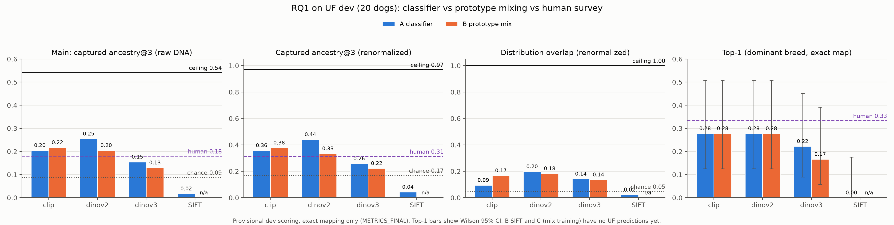
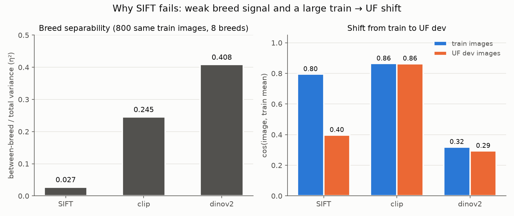

# A · B · C 결과 비교와 해석 (RQ1, dev)

A 분류기(단일 품종 학습), B 평균점 섞기(FCLS, 학습 없음), C 섞기 학습(가짜 믹스로 비율 학습)을 비교한다.
파일 이름은 처음 A · B 비교로 만들 때의 것을 유지한다.

- **같은 예측 형식 · 같은 채점 코드:** 세 담당의 예측을 `scripts/collect_rq1_preds.py`로 공용 형식 한 폴더(dev 행만)에 모으고, `scripts/compare_rq1_dev.py`가 `provisional_score_uf.py`의 함수로 한 번에 채점한다. 정의는 `docs/METRICS_FINAL.md`(정확 매핑, 시드 · 반복 1~3 확률 평균 후 채점, 찍기 대비 · 방법 간 비교는 개 단위 짝 차이 ± 2SE).
- **재현 확인:** 이 코드로 낸 A 값(0.205 / 0.255 / 0.155 / 0.017)과 C 값(0.167 / 0.205 / 0.155 / 0.038, Top-1 4 / 4 / 3 / 0)은 각 담당이 직접 낸 값과 같다.
- **평가 대상:** 믹스견 dev 20마리(Top-1 채점 가능 18마리, coverage 90%). 순종은 세 방법 모두 val dev 절반 2,540장.
- **B의 SIFT:** C가 A에게 준 것과 같은 SIFT 특징(`sift_all_v2.npy`, `sift_eval_uf.npy`)을 `scripts/import_sift_from_c.py`로 공용 형식에 옮겨 로컬 CPU에서 실행했다(L2 없음, 반복 3회). 특징을 새로 뽑지 않았다.
- **아직 없는 것:** 세 방법의 hold 비율 지표(설정 고정 후 한 번).
- **결과 파일:** `results/dev_rq1_comparison.csv`, `dev_rq1_paired.csv`, `dev_rq1_equal_weight.csv`, `purebred_top1_same_set.csv`, `dev_combo_analysis.csv`, `improve_dev_full.csv`, `improve_dev.csv`, 그림 `figures/dev_rq1_with_human.png`

## 1. 한눈에 보기

**믹스견 dev 포착@3 (원래 비율, 주 지표).** 찍기 0.088, 상한 0.541, UF 설문 응답 0.180

| 추출기 | A 분류기 | B 평균점 섞기 | C 섞기 학습 |
|---|---|---|---|
| CLIP | 0.205 | 0.217 ▲ | 0.167 |
| DINOv2 | 0.255 ▲ | 0.205 ▲ | 0.205 |
| DINOv3 | 0.155 | 0.130 | 0.155 |
| SIFT | 0.017 ▼ | 0.000 ▼ | 0.038 |

▲ 찍기보다 높음, ▼ 찍기보다 낮음, 표시 없음은 판단 불가 (개 단위 짝 차이 ± 2SE)

**SIFT 행은 믹스견 결과로 쓰지 않는다.** UF 사진의 SIFT 특징이 학습셋과 다른 시각 단어 공간(다른 코드북)에서 만들어졌다(⑥(a) 2). 순종 Top-1의 SIFT 값은 학습셋과 같은 공간이라 유효하다.

**순종 Top-1 (val dev 절반 2,540장, 시드 · 반복 3회 평균)**

| 방법 | SIFT | CLIP | DINOv2 | DINOv3 |
|---|---|---|---|---|
| A 분류기 | 0.091 | 0.723 | 0.860 | 0.879 |
| B 평균점 섞기 | 0.071 | 0.619 | 0.808 | 0.822 |
| C 섞기 학습 | 0.077 | 0.753 | 0.839 | 0.856 |
| C 단일 라벨 대조 | 0.074 | 0.771 | 0.842 | 0.870 |

## 2. 해석

### ① 순종에서는 방법 차이가 보인다

같은 2,540장에서 DINOv2 · DINOv3는 A > C > B 순서이고, B는 A보다 5~6%p 낮다. B는 품종마다 평균 하나만 보고 닮은 품종의 평균을 조금씩 섞어 쓰므로 1위가 흐려진다(`figures/purebred_confusions.png`). C는 단일 라벨 대조보다 0.003~0.018 낮을 뿐이어서, 섞기 학습이 순종에서 치르는 비용은 작다.

CLIP은 순서가 다르다. C의 단일 라벨 대조(0.771)가 A(0.723)보다 높다. 둘 다 단일 라벨 학습이고 입력 처리(C: z-score, A: L2 + 균형 가중치)와 최적화만 다르다. **CLIP에서는 입력 처리의 영향이 풀이 방식 차이만큼 크다.** 그래서 "세 방법의 차이는 풀이 방식에서만 나온다"고 쓰지 않는다.

### ② 믹스견에서는 방법 차이를 판단할 수 없다

방법 짝 9개(추출기 3종 × A-B · A-C · B-C) 가운데 8개가 판단 불가다. 예외는 DINOv2의 A − B(+0.050 ± 0.046)인데, 구간 끝이 0에 가깝고 다중 비교 보정 전 값이라 A 우위로 쓰지 않는다. C는 세 딥 추출기 모두 A와 같거나 낮다(차이 0.000~0.050, 모두 판단 불가). 비율을 직접 맞히도록 학습해도 실제 믹스견에서 이득이 드러나지 않는다.

→ **RQ1 잠정 답: 풀이 방식의 차이는 순종에서는 보이지만 믹스견에서는 판단할 수 없을 만큼 작다. 세 방법 모두 CLIP · DINOv2에서 찍기 이상, DINOv3에서는 판단 불가다.**

### ③ 세 방법은 대체로 같은 개를 맞힌다

개별 포착@3 점수의 상관은 A-B 0.88~0.97, A-C 0.68~0.84, B-C 0.58~0.82다. 딥 추출기 3종 × 세 방법 9개 설정 가운데 하나라도 Top-1을 맞힌 개는 18마리 중 9마리뿐이다. 어떤 개는 어느 방법 · 추출기로도 맞히지 못한다. 병목이 풀이 방식보다 **개 쪽**(사진 조건, 학습 품종 밖 혈통, 외형에 드러나지 않는 혈통)에 있다는 해석과 맞고, 이는 RQ2(어떤 시각 단서에 기대는가)로 이어진다.

### ④ 순종 순위가 믹스견 순위로 이어지지 않는다

순종 1위인 DINOv3가 믹스견 포착@3에서는 세 방법 모두 딥 추출기 중 가장 낮거나 같다(A hold Top-1에서도 1위가 아님). 방법이 달라도 같은 방향이다. 다만 차이는 모두 구간 안이므로 "DINOv3가 믹스견에서 나쁘다"가 아니라 "순종 성능이 믹스견 성능을 보장하지 않는다"까지만 말한다.

### ⑤ 결합 모델: dev에서 성능을 올린다는 근거가 없다

`scripts/combo_analysis_dev.py` → `results/dev_combo_analysis.csv` (딥 추출기 3종 × 세 방법 = 9개 설정, 포착@3 원래 비율)

| 분석 | 결과 |
|---|---|
| 여지 (오라클) | 개마다 9개 설정 중 최고를 골라도 0.255로 A DINOv2 단독과 같다. 20마리 모두에서 A DINOv2가 최고이거나 공동 최고이고, 다른 설정이 더 높은 개는 없다. 9개 설정이 모두 0인 개는 6마리 |
| 결합 방식 (같은 가중치) | 산술 평균(9개) 0.267만 단일 최고보다 높다. 기하 평균 0.167, 순위 합산 0.135, 상위 3 투표 0.217은 모두 낮다 |
| 산술 평균의 이득 | +0.013 ± 0.025(판단 불가). 20마리 중 1마리에서만 0.25 더 맞혔고 나머지 19마리는 A DINOv2와 같다 |
| 한 마리씩 빼고 고르기 | 19마리로 후보(단일 9개 + 결합 28개) 중 최고를 고르고 뺀 개에 적용하면 0.255. 단일 최고와 차이 0 |
| 부트스트랩 2,000회 | 9개 산술 평균이 같은 표본의 단일 최고를 이긴 비율 65% |

다른 방법 · 추출기가 맞히는 개는 A DINOv2가 맞히는 개의 부분집합이어서, 섞어도 새로 맞힐 개가 거의 없다. ③(세 방법이 같은 개를 맞힌다)을 개체 단위로 확인한 결과다. 같은 가중치 결합의 다른 묶음(방법별, 추출기별)은 `results/dev_rq1_equal_weight.csv`에도 있다.

주의: A DINOv2가 최고라는 것도 같은 20마리에서 본 것이다. 이 분석으로 말할 수 있는 것은 "결합이 이득을 준다는 근거가 dev에 없다"까지이고, "A DINOv2가 가장 좋다"는 아니다. 결합 모델은 연구 질문 판정에 쓰지 않는다. 데모에 쓴다면 dev 점수로 고르지 않고 미리 정한 규칙(예: 9개 산술 평균, 또는 단일 설정 하나)으로 정한다. 결정은 팀이 한다.

### ⑥ 진단: SIFT가 낮은 이유, 불리 계열 쏠림, 어려운 개

코드는 `scripts/feature_diagnostics.py`, 결과는 `results/feature_separability.csv`, `feature_eval_shift.csv`, `pred_concentration.csv`, `bully_bias.csv`, `dog_difficulty.csv`, 그림은 `figures/sift_diagnostics.png`다. 평가셋 특징은 dev 패널 40장만 쓰고 hold는 쓰지 않았다. 개별 개 값은 저장하지 않고 묶음 집계만 남긴다.

**(a) SIFT: 순종에서는 품종 신호가 약하고, 믹스견 결과는 특징 공간 불일치 때문에 쓸 수 없다.**

1. **순종 학습셋 안에서도 품종 신호가 약하다.** 세 추출기 모두에 있는 같은 학습 사진 800장(8품종 × 100장)으로 비교했다. 품종이 설명하는 분산 비율(η²)은 SIFT 0.027, CLIP 0.245, DINOv2 0.408이다. 품종 평균점끼리의 cos는 SIFT 0.984로, 평균점들이 거의 한 점에 모인다. 가장 가까운 평균점으로 맞힌 비율은 학습 사진 그대로 재도 0.44(찍기 0.125)로, CLIP 0.87, DINOv2 0.93과 차이가 크다. 127클래스 학습셋 전체에서도 SIFT의 η²는 0.039, 품종 안 흩어짐은 품종 사이 거리의 24배이고, 자기 품종 평균점이 가장 가까운 사진은 10.7%뿐이다. BoVW 히스토그램은 국소 기울기 패턴(털 결, 모서리)이 몇 번 나왔는지만 센다. 귀 · 주둥이 · 몸 비율처럼 품종을 가르는 배치 정보는 남지 않는다. 순종 Top-1 7~9%와 맞는 결과다.
2. **UF 사진의 SIFT 특징은 학습셋과 다른 시각 단어 공간에 있다 (코드북 불일치).** C의 `methodology_C.md` 10절 2항에 따르면, SIFT 추출 셀이 저장된 코드북을 그대로 쓰지 않고 `MiniBatchKMeans(init=centers, max_iter=1).fit(centers)`로 한 번 더 학습했고 `random_state`가 없어, 학습 특징(`sift_all_v2.npy`)과 UF 특징(`sift_eval_uf.npy`)의 단어 번호가 서로 다른 모양을 가리킨다. B가 로컬에서 확인했다(C 문서가 근거로 든 `sift_analysis.md`는 받지 못했다).
   - **단어별 사용 비율의 순위 상관 (512 단어):** 학습셋 vs val 0.970, 학습셋 vs val 40장 0.904, **학습셋 vs UF dev 40장 0.234**, 단어 순서를 무작위로 섞으면 −0.006. 같은 코드북이면 40장으로도 0.9 근처가 나와야 한다. UF에서 가장 많이 쓰인 단어 20개는 학습셋에서 512개 중 중간(순위 중앙값 224)이다.
   - **키포인트 수로는 설명되지 않는다.** UF 사진은 키포인트가 학습셋의 약 3분의 1이다(`scripts/count_sift_keypoints.py`, `results/sift_keypoints.csv`: 중앙값 144 대 390, 사진이 작아 336×336으로 확대되며 흐려짐). 그러나 학습 · val 사진 중 UF처럼 단어가 적게 잡힌 사진(쓰인 단어 80~130개, 10,522장)만 골라도 학습셋 전체와의 상관이 0.936(40장)~0.978이다. 단어가 적은 것만으로는 0.23이 나오지 않는다. 앞서 이 절에 "파이프라인 버그가 아니라 입력 사진의 차이"라고 적었던 판단은 이 점검으로 바뀌었다.
   - 0인 칸 비율 0.60 → 0.80, 학습셋 평균과의 cos 0.75~0.80 → 0.40의 분포 이동(`feature_eval_shift.csv`)도 이 불일치와 키포인트 감소가 겹친 결과로 읽는다. CLIP(0.864 → 0.864)과 DINOv2(0.320 → 0.294)는 학습 · 평가 특징을 B가 같은 코드로 뽑아 이런 문제가 없다.
   - **영향 범위:** A · B · C 세 방법의 SIFT 믹스견 결과 전부(A·B는 `sift_eval_uf.npy`를 썼고, C의 SIFT 믹스견 예측 `pred_eval_uf_v2-sift-*`가 어느 UF 파일로 만들어졌는지는 코드로 확인되지 않음). 순종 결과(학습 · val이 같은 `sift_all_v2.npy`)와 딥 특징 결과는 영향이 없다.
   - **바로잡는 방법:** UF 패널 SIFT를 학습 특징과 같은 코드북으로 다시 뽑아야 한다. 학습 특징에 실제로 쓰인 코드북(한 번 더 학습된 것)이 남아 있지 않으면, 저장된 `sift_codebook.npy`로 학습셋 · UF를 모두 다시 뽑아야 한다. C 담당 작업이다.
3. **풀이 방식마다 무너지는 모양이 다르다** (`pred_concentration.csv`). A는 거의 균일한 분포를 낸다(최대 확률 평균 0.07, 실질 품종 수 81). B는 평균점이 거의 같아 FCLS가 몇 품종에 몰아 준다(실질 3.5품종, 20마리의 Top-1이 3종뿐이고 그중 Japanese_Spitzes가 9마리). C는 Top-1이 17종으로 다양하지만 맞히지 못한다. 결과는 셋 다 찍기 이하이거나 판단 불가로 같다. 다만 위 2의 불일치 때문에 이 모양은 "SIFT가 믹스견에서 어떻게 동작하는가"가 아니라 "엉뚱한 단어 공간의 입력을 받았을 때 어떻게 무너지는가"로 읽는다.

**(b) 불리 계열(AmStaff · Staffordshire_bullterrier) 쏠림은 오답이 아니라 정답 쪽 신호다.**

딥 설정 9개 중 7개에서 가장 흔한 Top-1이 이 두 품종이다. 모델이 "단모 중형 믹스 → AmStaff"로 쏠리는 것인지 확인했다. dev 20마리 가운데 9마리가 정확 매핑 기준으로 이 혈통을 가진다(표본 자체에 이 혈통이 많다). 그리고 Top-1으로 불리를 고른 경우는 딥 9개 설정에서 49번 중 48번이 실제로 그 혈통이 있는 개였다(DINOv3 A만 1번 틀림). 불리 클래스에 준 예측 확률 몫의 평균(0.12~0.27)도 실제 비율 몫의 평균(0.175)과 비슷한 범위다. 오히려 아래 (c)처럼 **dev 성능의 상당 부분이 이 9마리에서 나온다.** 그래서 dev 점수가 "믹스견 전반"을 대표한다고 쓰지 않고, hold에서 불리 혈통 비율이 다르면 점수가 크게 달라질 수 있다고 적는다. SIFT는 세 방법 모두 불리를 한 번도 고르지 않았다.

**(c) 어려운 개: 매핑 범위와 불리 혈통 여부가 가른다** (딥 9개 설정, `dog_difficulty.csv`)

| 개 묶음 | 마리 | Top-1 채점 | 하나라도 맞힘 | 맞힌 설정 수 평균 | 포착@3 평균 | 상한 대비 |
|---|---|---|---|---|---|---|
| 전체 | 20 | 18 | 9 | 2.1 | 0.188 | 0.35 |
| coverage < 0.5 | 8 | 6 | 3 | 1.2 | 0.068 | 0.20 |
| coverage ≥ 0.5 | 12 | 12 | 6 | 2.6 | 0.269 | 0.40 |
| 불리 혈통 있음 | 9 | 9 | 7 | 2.7 | 0.312 | 0.56 |
| 불리 혈통 없음 | 11 | 9 | 2 | 1.6 | 0.087 | 0.17 |
| 주 품종 비율 < 40% | 13 | 12 | 7 | 2.7 | 0.129 | 0.28 |
| 주 품종 비율 ≥ 40% | 7 | 6 | 2 | 1.0 | 0.298 | 0.43 |

- **매핑 밖 혈통:** coverage가 낮은 개는 상한이 0.34밖에 안 되는데, 그 상한의 20%만 채운다. 실패의 일부는 시각 문제가 아니라 학습 품종 공간 밖 혈통 때문이다. 상한 대비로 보면 전체 평균도 35%다.
- **불리 혈통이 없는 개는 거의 못 맞힌다.** Top-1을 하나라도 맞힌 개가 9마리 중 2마리, 상한 대비 17%다. 불리 계열은 학습셋에 있고 외형(넓은 머리, 단모, 근육형 몸)이 뚜렷해 혼합되어도 잘 드러나는 것으로 보인다. 이는 RQ2(어떤 시각 단서에 기대는가)에서 D의 변형(흑백 · 질감 제거 등)으로 확인할 만한 가설이다.
- **주 품종 비율:** 비율이 40% 이상인 개는 포착@3가 높지만, Top-1을 맞힌 설정 수는 오히려 적다(1.0 대 2.7). 묶음이 6~7마리라 해석하지 않고 hold에서 다시 본다.
- 모든 묶음이 4~16마리라 구간을 내지 않았다. 방향만 읽고 수치 결론으로 쓰지 않는다.

### ⑦ 개선 시도와 설정 고정 (2026-11-25)

**개선 시도: 공식 설정(CLS)을 넘는 것이 없었다.** 순종만 학습하는 틀은 그대로 두고, 특징 종류(CLS · 패치 평균 · 둘을 이어 붙인 것) × 풀이 방식(A 분류기 · B 평균점 섞기 · C 섞기 학습)을 딥 추출기 3종에서 다시 돌렸다. 학습셋 전체(Colab, `scripts/improve_from_shards.py` → `scripts/improve_eval.py`, 결과 `results/improve_dev_full.csv`)와 품종당 30장(로컬 CPU, `results/improve_dev.csv`) 두 가지로 했다. 후보는 미리 정했고, 시험 시 증강은 쓰지 않았고, hold는 쓰지 않았다.

| 점검 | 결과 (학습셋 전체, dev 포착@3) |
|---|---|
| 재현 | CLS 설정이 공식 값을 재현한다. B는 세 추출기 모두 같고, A는 CLIP만 0.217(공식 0.205)이다. C는 재학습해서 DINOv2 0.192(공식 0.205), DINOv3 0.205(공식 0.155)로 흔들린다 |
| 패치 평균 | CLS를 넘는 조합 없음. DINOv2에서 A −0.105 ± 0.066, B −0.142 ± 0.084로 낮다. DINOv3 C도 −0.087 ± 0.075로 낮다 |
| 이어 붙이기 | 9개 모두 −0.087~+0.013. 오른 쪽은 모두 판단 불가다 |
| 대리 지표로 고르기 | UF를 쓰지 않는 지표(순종 Top-1, 특징 공간 가짜 믹스)로 고른 설정의 dev 점수: DINOv2 0.205, CLIP 0.180, DINOv3 0.130. 세 추출기 모두 dev 최고 설정이 아니다 |
| 19마리로 고르기 (LOO) | DINOv2 0.255, CLIP 0.217, DINOv3 0.205. 추출기별 CLS 단일 최고와 같다 |

- **가짜 믹스로는 실제 믹스견 성능을 예측하지 못한다.** 특징 공간 가짜 믹스에서는 B · C가 A만큼 또는 그보다 높게 나오지만(예: DINOv2 0.792 · 0.777 대 0.753), 실제 dev에서는 그 우위가 보이지 않는다. B와 C는 둘 다 "순종 특징을 섞으면 믹스견 특징이 된다"는 가정 위에 있다. 이 결과는 그 가정이 실제 믹스견에서 맞지 않는다는 근거로, ②(혼합 전용 방법의 이득이 드러나지 않음)와 같은 방향이다.
- **dev 점수는 조건에 따라 0.05씩 흔들린다.** 학습셋 크기만 바꿔도 B DINOv2가 0.255(품종당 30장)에서 0.205(전체)로 바뀌었고, 재학습만으로 C DINOv3가 0.155에서 0.205로 바뀌었다. dev 20마리로 설정을 고르면 이 흔들림을 고르게 된다.
- ⑤(결합 모델)와 합치면, 결합 · 특징 종류 · 학습셋 크기 어느 것도 공식 설정보다 낫다는 근거가 없다. 병목은 모델 선택보다 순종→믹스 간극과 매핑 범위(상한 0.541, 평균 coverage 0.567)에 있다고 해석한다.

**설정 고정 (hold 채점 전).** 위 결과로 설정을 바꾸지 않는다. hold 80마리는 아래 설정으로 한 번만 채점한다.

| 항목 | 고정 내용 |
|---|---|
| 특징 | 추출기별 CLS(CLIP은 투영 후 이미지 임베딩). 공용 샤드 그대로 |
| A 분류기 | A의 공식 실행 `RQ1-{bb}-clf-s1~s3` (가중치 `A/A/A_to_D_handoff/`) |
| B 평균점 섞기 | `RQ1-{bb}-proto-r1~r3`: 학습셋 80% 부분 표본 평균점, FCLS, L2 없음 |
| C 섞기 학습 | C의 공식 실행 `RQ1-{bb}-mix-v2-s1~s3-lr3e-3` (체크포인트 `C/C_add/`, B가 dev 예측 재현 확인: 개 단위 최대 차이 1e-6, 1위 일치 9/9) |
| 채점 | 시드 · 반복 1~3 확률 평균 후 `METRICS_FINAL` 지표, `compare_rq1_dev.py`와 같은 함수. 개선 실험의 재학습 값(예: C DINOv3 0.205)은 쓰지 않는다 |
| 결합 | 쓰지 않는다 (⑤) |
| SIFT | 세 방법 모두 v2 특징(`sift_all_v2.npy` + `sift_eval_uf.npy`)으로 채점한다. 믹스견 SIFT 결과는 보고하되 코드북 불일치(⑥(a) 2) 때문에 해석하지 않는다. v3는 원인 검증용 (2026-11-25 결정) |
| 대표 설정 | 정하지 않는다. hold 결과를 보고 팀이 정한다 (2026-11-25 팀 결정). hold를 본 뒤의 선택이므로 확인적 결론이 아니라 기술적 선택으로 표시하고, hold는 방법 × 추출기 모든 칸을 그대로 보고한다. dev에서는 A 분류기 + DINOv2가 가장 높았지만 다른 설정과의 차이는 대부분 판단 불가다 |
| 데모 | DINOv2 + CLS 하나에 A · B · C 세 풀이를 나란히 적용한다. 데모용 선택이며 성능 보증이 아니다 |

## 3. 남은 일

| 할 일 | 담당 | 이유 |
|---|---|---|
| 세 방법 hold 비율 지표 한 번 채점 (⑦의 고정 설정으로) | 팀 확인 필요 | RQ1의 test 결과. 지금 test에는 A의 Top-1만 있음 |
| ~~성능 개선 실험~~ | 해결 | ⑦: 특징 종류 · 대리 지표 선택 모두 CLS를 넘지 못함. 설정 고정 (2026-11-25) |
| ~~방법 간 검정 방법 확정~~ | 해결 | 보고서 3.4를 코드 기준(개체 단위 짝 차이 ± 2SE, 보정 없음)으로 맞춤 (2026-11-24) |
| 결합 모델 여부 확정 (hold 전에) | 팀 | B 제안: 쓰지 않음(⑤ · ⑦). 팀이 다르게 정하면 ⑦ 표를 고친다 |
| ~~UF SIFT를 학습 특징과 같은 코드북으로 다시 추출~~ | 하지 않음 | 2026-11-25 결정: RQ1 SIFT는 v2로 보고하고 해석하지 않는다. 저장 코드북으로 다시 뽑은 v3(C `sift_analysis.md`)는 원인 검증용으로만 쓴다 |
| 대표 설정 정하기 | 팀 (hold 채점 후) | 2026-11-25 팀 결정. ⑦ 표 참고 |
| C의 SIFT 믹스견 예측(`pred_eval_uf_v2-sift-*`)이 어느 UF SIFT 파일로 만들어졌는지 | C에게 확인 | `deep_mix_train.py`에 SIFT 부분은 "확인 필요"로만 적혀 있음 |
| 불리 혈통 여부별 점수를 hold에서도 집계 | B (hold 한 번 할 때 같이) | ⑥(b)(c) dev 성능이 불리 혈통 9마리에 몰려 있음 |

## 4. 보고서용 문장 (초안)

> 같은 dev 20마리에서 세 풀이 방식의 포착 혈통 비율은 CLIP 0.167~0.217, DINOv2 0.205~0.255, DINOv3 0.130~0.155였고, 방법 사이의 개 단위 차이는 9개 비교 가운데 8개에서 판단 불가였다. 반면 같은 순종 사진 2,540장에서는 분류기와 섞기 학습이 평균점 섞기보다 2~13%p 높았다. 세 방법의 개별 점수는 서로 높은 상관을 보였고, 9개 설정 중 어느 하나라도 Top-1을 맞힌 개는 18마리 중 9마리였다. 풀이 방식보다 개체의 특성이 결과를 더 크게 가른다는 점을 시사한다.

> SIFT BoVW는 순종 학습 사진 안에서도 품종이 설명하는 분산이 2.7%(같은 800장에서 CLIP 24.5%, DINOv2 40.8%)에 그쳤다. 믹스견 평가용 SIFT 특징은 학습 특징과 다른 시각 단어 공간에서 만들어져(단어 사용 비율의 순위 상관 0.23, 같은 공간의 val 0.90), SIFT의 믹스견 결과는 보고하지 않는다. 딥 특징의 dev 성능은 불리 계열 혈통을 가진 9마리에 몰려 있었고(상한 대비 포착 56% 대 17%), 학습 품종 공간 밖 혈통이 많은 개는 상한 자체가 낮았다.

> 특징 종류(CLS · 패치 평균 · 이어 붙이기)와 결합(같은 가중치 평균)을 바꿔 보았지만, dev에서 공식 설정(CLS, 단일 방법)보다 높다는 근거가 있는 조합은 없었다. 특징 공간에서 순종 특징을 섞어 만든 가짜 믹스로 고른 설정은 세 추출기 모두 실제 믹스견 dev에서 최고가 아니었다. 이는 평균점 섞기와 섞기 학습이 기대는 "특징의 섞기 = 혈통의 섞기" 가정이 실제 믹스견에서 성립하지 않음을 시사한다. 따라서 설정은 dev 결과로 바꾸지 않고 고정한 채 hold에서 한 번 평가한다.
