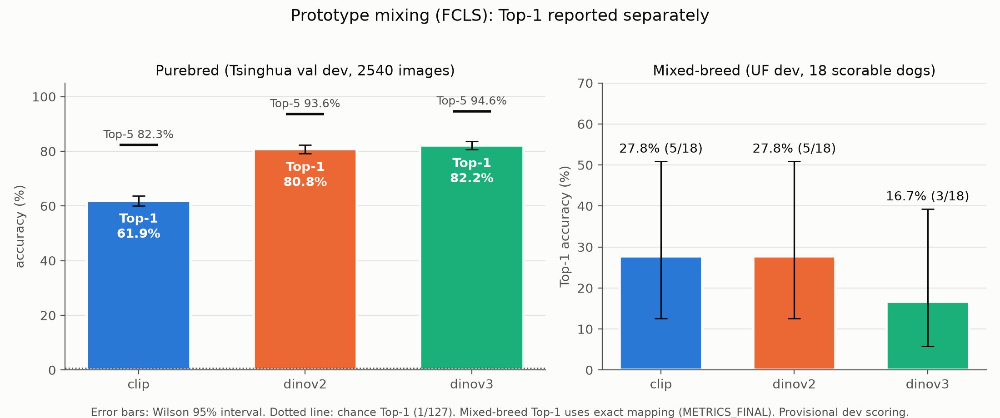
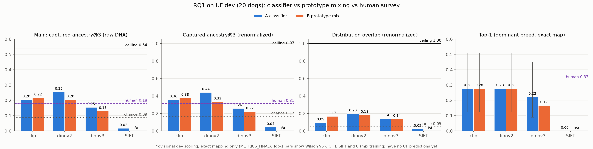

# B파트 dev 결과: 평균점 섞기(FCLS), 임시 채점

> **임시 채점이다.** A의 `eval.py`가 나오기 전에 B의 채점 스크립트(`scripts/provisional_score_uf.py`, `scripts/provisional_score_purebred.py`)로 낸 dev 값이다. 정식 값은 `eval.py`로 다시 낸다. test(UF hold, val test 절반)는 쓰지 않았다.
>
> **지표 정의가 바뀌었다(2026-11-24).** 이제 [METRICS_FINAL.md](METRICS_FINAL.md)를 따른다(매핑 정확만, 주 지표 = 원래 비율 포착@3). 믹스견 값은 Drive의 B 예측 18개를 2026-11-24에 내려받아 이 기준으로 다시 채점했다(2 · 3 · 6 · 8절, 그림 모두 반영). 이전 Top-1(정확 + 유사, 19마리)은 CLIP 5/19 · DINOv2 5/19 · DINOv3 3/19였다. 포착 혈통 비율은 다시 채점해도 같았다(DNA 품종 합산 수정의 영향 없음). 전체 집계는 [dev_scores_final.csv](../results/dev_scores_final.csv).

- 출처: 순종은 Colab 노트북 `notebooks/B_colab_run.ipynb` 순종 채점 셀 출력(2026-11-23). 믹스견은 Drive 예측을 로컬에서 `provisional_score_uf.py --summary-csv`로 다시 채점(2026-11-24), `summarize_results.py`가 `raw_dev_scores.csv`에 반영
- 집계값: [raw_dev_scores.csv](../results/raw_dev_scores.csv), [purebred_confusions.csv](../results/purebred_confusions.csv). 개별 개의 DNA 값은 들어 있지 않다
- 그림: `python scripts/plot_results.py` (L2 설정은 `--l2`) → [../figures/](../figures/)
- 대표값: 반복 r1~r3의 확률을 평균한 뒤 채점한 값. 괄호는 반복별 최소~최대

## 1. 순종 보조 평가 (Tsinghua val dev, 2,540장, 127클래스)

| 추출기 | Top-1 | Top-5 |
|---|---|---|
| CLIP | 61.9% (61.8~62.5) | 82.3% |
| DINOv2 | 80.8% (80.6~80.9) | 93.6% |
| DINOv3 | **82.2%** (82.1~82.4) | **94.6%** |

- 무작위 기준 Top-1은 0.8%(1/127)다.
- DINOv3 ≥ DINOv2 ≫ CLIP. 2,540장이라 Wilson 95% 구간이 ±1.5%p 안팎으로 좁다. DINOv3와 DINOv2의 차이(1.4%p)는 구간 경계에 걸친다.
- Top-5 대표값이 반복별 Top-5 범위보다 높은 것은 오류가 아니다. 확률을 평균하면 0이던 클래스가 살아나 상위 5위 안에 드는 경우가 늘어난다(FCLS는 대부분 클래스에 0을 준다).

## 2. 믹스견 Top-1 (UF dev, 20마리 중 채점 가능 18마리, 정확 매핑)

정답은 DNA 비율 1위 품종(동률이면 그중 하나)에 정확 매핑된 클래스다. 1위 품종이 정확 매핑 범위 밖인 2마리는 분모에서 뺐다(Coverage 90%).

| 추출기 | Top-1 | 맞힌 수 | Wilson 95% 구간 |
|---|---|---|---|
| CLIP | 27.8% (22.2~38.9) | 5/18 | 12.5~50.9% |
| DINOv2 | 27.8% | 5/18 | 12.5~50.9% |
| DINOv3 | 16.7% | 3/18 | 5.8~39.2% |

- 추출기 사이의 차이는 **2마리**다. 구간이 크게 겹쳐서 순위를 말할 수 없다.

## 3. 믹스견 포착 혈통 비율 (보고서 주 지표)

예측 상위 3품종이 차지하는 실제 DNA 비율의 합. 상한은 실제 상위 3품종을 그대로 맞혔을 때의 값이다.

| 대상 | 추출기 | 대표값 | 찍기 | 찍기와 차이 ± 2SE | 판단 | 상한 |
|---|---|---|---|---|---|---|
| dev 전체 20마리 | CLIP | 0.217 | 0.088 | +0.129 ± 0.125 | 찍기보다 높음 | 0.541 |
| | DINOv2 | 0.205 | 0.088 | +0.117 ± 0.112 | 찍기보다 높음 | |
| | DINOv3 | 0.130 | 0.088 | +0.042 ± 0.108 | 판단 불가 | |
| DNA coverage ≥ 0.5 (12마리) | CLIP | 0.312 | 0.083 | +0.229 ± 0.179 | 찍기보다 높음 | 0.675 |
| | DINOv2 | 0.292 | 0.083 | +0.208 ± 0.161 | 찍기보다 높음 | |
| | DINOv3 | 0.188 | 0.083 | +0.104 ± 0.168 | 판단 불가 | |

- 상한이 0.541밖에 안 되는 것은 DNA 품종의 상당 부분이 Tsinghua 127클래스 밖이기 때문이다. 학습 품종 안에서 다시 나눈 비율로 보면 상한은 0.970이고, CLIP 0.378 · DINOv2 0.334 · DINOv3 0.222다(모두 판단 불가).

## 4. L2 정규화

L2를 켜도 끄도 거의 같다. 순종 Top-1 차이는 −0.2~+0.1%p, 믹스견 Top-1은 같고, 포착 혈통 비율도 최대 +0.015(판단 불가)다. **정식 dev 채점에서 뒤집히지 않으면 L2 없음으로 고정할 것을 제안한다**(설정이 하나 줄어든다). L2 그림은 `figures/*_l2.png`.

## 5. 순종에서 자주 헷갈린 쌍 (DINOv3 + L2)

- collie → Shetland_sheepdog(46), English_foxhound → Walker_hound(22), Pembroke → Cardigan(14)처럼 생김새가 비슷한 품종끼리 헷갈린다.
- toy_poodle · miniature_poodle → teddy는 DNA 품종으로 묶으면(Poodle) 같은 품종이라 틀린 것이 아니다. 묶은 기준에서 DINOv3 Top-1은 83.5%로 오른다.
- Top-1이 낮은 클래스: toy_poodle 0.12, collie 0.18, papillon 0.22, miniature_poodle 0.37.

## 6. A 분류기와 비교 (RQ1)

A의 믹스견 dev와 B의 UF dev는 **같은 20마리**다(`A/configs/split.csv`와 `eval_index_UF_panels.csv`의 dev 목록이 같다). 정확 매핑으로 채점 가능한 18마리, Coverage 90%도 같다. 그래서 믹스견 dev Top-1은 두 방법을 바로 비교할 수 있다. A 값은 믹스견 `A/A/results/dev_ratio_metrics_exact.csv`, 순종 `A/results/model_summary.csv`에서 읽는다.

| 추출기 | 믹스견 dev Top-1: A 분류기 | 믹스견 dev Top-1: B 평균점 섞기 | 순종 Top-1: A (val 전체) | 순종 Top-1: B (val dev 절반) |
|---|---|---|---|---|
| CLIP | 27.8% (5/18) | 27.8% (5/18) | 72.5% | 61.9% |
| DINOv2 | 27.8% (5/18) | 27.8% (5/18) | 85.6% | 80.8% |
| DINOv3 | 22.2% (4/18) | 16.7% (3/18) | 87.9% | 82.2% |
| SIFT | 0.0% (0/18) | 아직 없음 | 9.5% | 아직 없음 |

- **믹스견:** CLIP과 DINOv2는 두 방법이 같은 수(5마리)를 맞혔다. DINOv3는 A가 4마리로 B(3마리)보다 수치상 높지만, Wilson 95% 구간(9.0–45.2% 대 5.8–39.2%)이 크게 겹치므로 우위라고 단정하지 않는다.
- **순종:** 세 추출기 모두 분류기(A)가 평균점 섞기(B)보다 5~11%p 높다. 다만 A는 val 전체, B는 그 절반이라 같은 사진 집합이 아니다. 같은 집합으로 맞추려면 A의 예측에서 val dev 절반(`evalset/val_split_seed1.csv`)만 다시 세면 된다.
- **두 방법에 공통인 방향:** 순종에서는 DINOv3가 가장 좋은데 믹스견에서는 CLIP · DINOv2보다 낮다. A의 hold 결과(80마리 중 71마리 채점)에서도 CLIP 14.1% > DINOv3 12.7% > DINOv2 11.3%로 DINOv3가 앞서지 않는다. 순종 정확도가 믹스견 혈통 복원으로 그대로 이어지지 않는다는 점은 보고서에서 다룰 만하다.

## 7. 읽는 법과 주의

1. **순종에서는 DINOv3가 가장 좋지만, 믹스견에서는 가장 낮게 나왔다.** 흥미로운 방향이지만 믹스견은 19~20마리라 차이가 2마리, 포착 혈통 비율도 구간이 겹친다. 지금은 "가설"로만 적고 D8의 hold(80마리)에서 확인한다.
2. CLIP과 DINOv2는 믹스견 포착 혈통 비율이 찍기보다 높다(dev 20마리, 2SE 기준). 평균점 섞기가 믹스견에서 아무것도 못 하는 것은 아니라는 근거다.
3. 이 값은 dev에서 **설정(L2 여부)을 정하는 데만** 쓴다. 추출기 순위를 결론으로 쓰지 않는다(보고서 6.1절).
4. **A의 최종 그림(`A/figures/final_purebred_vs_mixed_top1.png`)과는 바로 비교하지 않는다.** 그 그림은 순종 val 전체와 믹스견 hold(80마리)이고, B는 hold를 아직 쓰지 않았다. 같은 조건의 비교는 6절의 dev 비교다. A가 hold를 이미 한 번 평가했으므로(`A/results/HOLD_EVALUATED_ONCE.json`), B도 설정을 고정한 뒤 hold를 한 번만 평가할지 팀에서 정한다.

## 8. 사람 기준선과 RQ1 dev 비교표 (2026-11-24 추가)

지표와 매핑은 [METRICS_FINAL.md](METRICS_FINAL.md)를 따른다(정확 매핑만). 사람 기준은 UF 페이지 설문 칸 "Top Responses"(`human_UF.csv`)다. 개마다 응답자들이 많이 고른 품종 5개가 순서대로 있고 비율은 없다. 그래서 포착 혈통 비율@3(앞 3품종)과 Top-1(첫 품종)만 낸다. 채점 코드는 [score_human_uf.py](../scripts/score_human_uf.py)이고, 모델과 같은 정답 · 매핑 · 찍기 · 상한을 쓴다. 이 스크립트로 다시 계산한 찍기 값(0.088 / 0.168, 정확 매핑)이 A · B 값과 같다.

| 방법 | 추출기 | **주 지표** 포착@3 원래 | 포착@3 재정규화 | 분포 겹침 재정규화 | Top-1 (18마리, coverage 90%) |
|---|---|---|---|---|---|
| A 분류기 | CLIP / DINOv2 / DINOv3 / SIFT | 0.205 / 0.255 / 0.155 / 0.017 | 0.358 / 0.441 / 0.258 / 0.043 | 0.095 / 0.198 / 0.142 / 0.023 | 5 / 5 / 4 / 0 |
| B 평균점 섞기 | CLIP / DINOv2 / DINOv3 | 0.217 / 0.205 / 0.130 | 0.378 / 0.334 / 0.222 | 0.167 / 0.183 / 0.136 | 5 / 5 / 3 |
| 사람 (UF 설문) | - | 0.180 | 0.313 | 없음(비율 없음) | 6 (33.3%) |
| 찍기 | - | 0.088 | 0.168 | 0.047 | - |
| 상한 | - | 0.541 | 0.970 | 1.000 | - |

- 표 전체: [dev_rq1_comparison.csv](../results/dev_rq1_comparison.csv). 사람 기준 세부(공식 정확 매핑과 참고용 정확 + 유사, 응답 고르는 방식 2가지): [dev_human_baseline.csv](../results/dev_human_baseline.csv)
- 사람과 찍기의 차이는 +0.092 ± 0.111이라 판단 불가다(20마리).
- 매핑 없이 품종 이름으로 바로 맞추면 사람의 포착 혈통 비율은 0.208이다(상한 0.738). MuttMix 평균 20.9%와 거의 같다. 단, MuttMix가 같은 방식으로 집계했는지는 원문에서 확인해야 한다.
- 딥 특징을 쓴 A · B는 주 지표에서 사람과 비슷하거나 수치상 조금 높다. Top-1은 사람이 1~3마리 많이 맞혔다. 모두 구간이 겹쳐 판단할 수 없다.
- 재정규화 분포 겹침은 B 세 추출기 모두 찍기(0.047)보다 높다(개 단위 짝 차이 ± 2SE). CLIP은 B 0.167이 A 0.095보다 수치상 높고, DINOv2 · DINOv3는 비슷하다. FCLS는 몇 품종에 비율을 몰아 주므로 분류기의 퍼진 확률보다 겹침에 유리할 수 있다.
- 설문 표기와 DNA 표기를 잇는 별칭(예: "German Shepherd Dog" → "German Shepherd")은 B가 정했다. 팀 확인이 필요하다(`score_human_uf.py`의 `ALIAS`).
- B 값은 Drive의 B 예측 18개(설정 6 × 반복 3)를 2026-11-24에 내려받아 수정된 `provisional_score_uf.py`로 다시 채점한 값이다(L2 없음). L2를 켜도 모든 지표에서 차이가 0.003 이하다.
