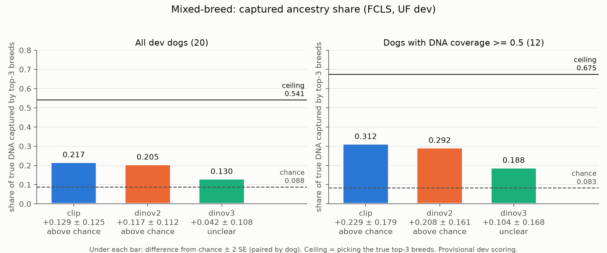
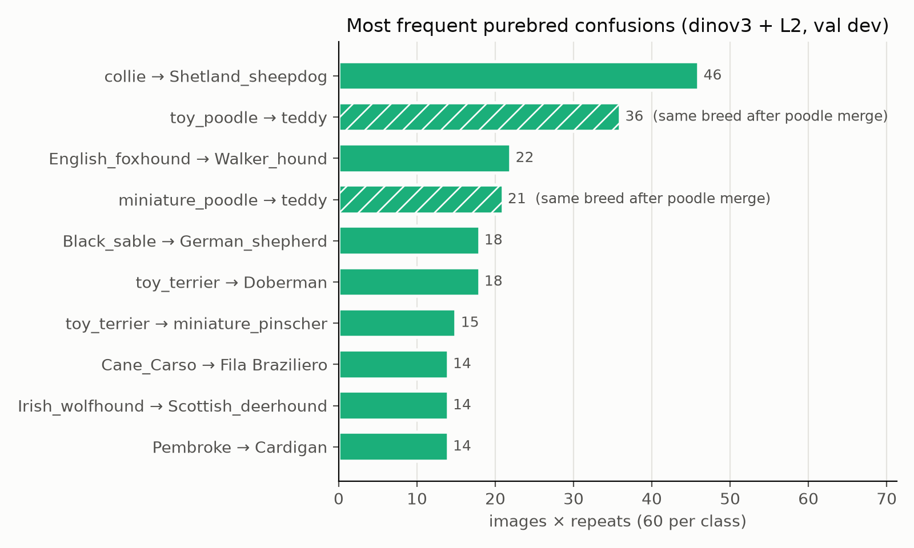
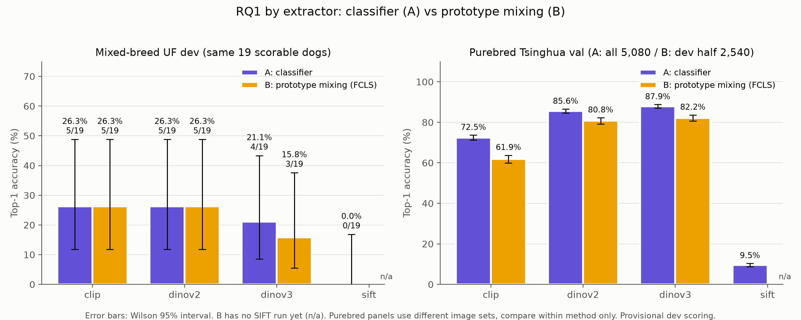

# B파트 dev 결과: 평균점 섞기(FCLS), 임시 채점

> **임시 채점이다.** A의 `eval.py`가 나오기 전에 B의 채점 스크립트(`scripts/provisional_score_uf.py`, `scripts/provisional_score_purebred.py`)로 낸 dev 값이다. 정식 값은 `eval.py`로 다시 낸다. test(UF hold, val test 절반)는 쓰지 않았다.

- 출처: Colab 노트북 `notebooks/B_colab_run.ipynb` 셀 10-3(믹스견)과 순종 채점 셀의 출력 (2026-11-23 실행)
- 집계값: [raw_dev_scores.csv](../results/raw_dev_scores.csv), [purebred_confusions.csv](../results/purebred_confusions.csv). 개별 개의 DNA 값은 들어 있지 않다
- 그림: `python scripts/plot_results.py` (L2 설정은 `--l2`) → [../figures/](../figures/)
- 대표값: 반복 r1~r3의 확률을 평균한 뒤 채점한 값. 괄호는 반복별 최소~최대

## 1. 순종 보조 평가 (Tsinghua val dev, 2,540장, 127클래스)

| 추출기 | Top-1 | Top-5 |
|---|---|---|
| CLIP | 61.9% (61.8~62.5) | 82.3% |
| DINOv2 | 80.8% (80.6~80.9) | 93.6% |
| DINOv3 | **82.2%** (82.1~82.4) | **94.6%** |

- 무작위 기준 Top-1은 0.8%(1/127)다.
- DINOv3 ≥ DINOv2 ≫ CLIP. 2,540장이라 Wilson 95% 구간이 ±1.5%p 안팎으로 좁다. DINOv3와 DINOv2의 차이(1.4%p)는 구간 경계에 걸친다.
- Top-5 대표값이 반복별 Top-5 범위보다 높은 것은 오류가 아니다. 확률을 평균하면 0이던 클래스가 살아나 상위 5위 안에 드는 경우가 늘어난다(FCLS는 대부분 클래스에 0을 준다).

## 2. 믹스견 Top-1 (UF dev, 20마리 중 채점 가능 19마리)

정답은 DNA 비율 1위 품종(동률이면 그중 하나)에 매핑된 클래스다. 1위 품종이 학습 클래스에 없는 1마리는 분모에서 뺐다(Coverage 95%).

| 추출기 | Top-1 | 맞힌 수 | Wilson 95% 구간 |
|---|---|---|---|
| CLIP | 26.3% (21.1~36.8) | 5/19 | 약 12~49% |
| DINOv2 | 26.3% | 5/19 | 약 12~49% |
| DINOv3 | 15.8% | 3/19 | 약 6~38% |

- 추출기 사이의 차이는 **2마리**다. 구간이 크게 겹쳐서 순위를 말할 수 없다.

## 3. 믹스견 포착 혈통 비율 (보고서 주 지표)

예측 상위 3품종이 차지하는 실제 DNA 비율의 합. 상한은 실제 상위 3품종을 그대로 맞혔을 때의 값이다.

| 대상 | 추출기 | 대표값 | 찍기 | 찍기와 차이 ± 2SE | 판단 | 상한 |
|---|---|---|---|---|---|---|
| dev 전체 20마리 | CLIP | 0.217 | 0.088 | +0.129 ± 0.125 | 찍기보다 높음 | 0.541 |
| | DINOv2 | 0.205 | 0.088 | +0.117 ± 0.112 | 찍기보다 높음 | |
| | DINOv3 | 0.130 | 0.088 | +0.042 ± 0.108 | 판단 불가 | |
| DNA coverage ≥ 0.5 (12마리) | CLIP | 0.312 | 0.083 | +0.229 ± 0.179 | 찍기보다 높음 | 0.675 |
| | DINOv2 | 0.292 | 0.083 | +0.208 ± 0.161 | 찍기보다 높음 | |
| | DINOv3 | 0.188 | 0.083 | +0.104 ± 0.168 | 판단 불가 | |

- 상한이 0.541밖에 안 되는 것은 DNA 품종의 상당 부분이 Tsinghua 127클래스 밖이기 때문이다. 학습 품종 안에서 다시 나눈 비율로 보면 상한은 0.970이고, CLIP 0.378 · DINOv2 0.334 · DINOv3 0.222다(모두 판단 불가).

## 4. L2 정규화

L2를 켜도 끄도 거의 같다. 순종 Top-1 차이는 −0.2~+0.1%p, 믹스견 Top-1은 같고, 포착 혈통 비율도 최대 +0.015(판단 불가)다. **정식 dev 채점에서 뒤집히지 않으면 L2 없음으로 고정할 것을 제안한다**(설정이 하나 줄어든다). L2 그림은 `figures/*_l2.png`.

## 5. 순종에서 자주 헷갈린 쌍 (DINOv3 + L2)

- collie → Shetland_sheepdog(46), English_foxhound → Walker_hound(22), Pembroke → Cardigan(14)처럼 생김새가 비슷한 품종끼리 헷갈린다.
- toy_poodle · miniature_poodle → teddy는 DNA 품종으로 묶으면(Poodle) 같은 품종이라 틀린 것이 아니다. 묶은 기준에서 DINOv3 Top-1은 83.5%로 오른다.
- Top-1이 낮은 클래스: toy_poodle 0.12, collie 0.18, papillon 0.22, miniature_poodle 0.37.

## 6. A 분류기와 비교 (RQ1)

A의 믹스견 dev와 B의 UF dev는 **같은 20마리**다(`A/configs/split.csv`와 `eval_index_UF_panels.csv`의 dev 목록이 같다). 채점 가능 19마리, Coverage 95%도 같다. 그래서 믹스견 dev Top-1은 두 방법을 바로 비교할 수 있다. A 값은 `A/results/dev_top1_model_summary.csv`, `A/results/model_summary.csv`에서 읽는다.

| 추출기 | 믹스견 dev Top-1: A 분류기 | 믹스견 dev Top-1: B 평균점 섞기 | 순종 Top-1: A (val 전체) | 순종 Top-1: B (val dev 절반) |
|---|---|---|---|---|
| CLIP | 26.3% (5/19) | 26.3% (5/19) | 72.5% | 61.9% |
| DINOv2 | 26.3% (5/19) | 26.3% (5/19) | 85.6% | 80.8% |
| DINOv3 | 21.1% (4/19) | 15.8% (3/19) | 87.9% | 82.2% |
| SIFT | 0.0% (0/19) | 아직 없음 | 9.5% | 아직 없음 |

- **믹스견:** CLIP과 DINOv2는 두 방법이 같은 수(5마리)를 맞혔다. DINOv3만 B가 1마리 적다. 두 방법의 차이는 0~1마리라 dev 20마리로는 가를 수 없다.
- **순종:** 세 추출기 모두 분류기(A)가 평균점 섞기(B)보다 5~11%p 높다. 다만 A는 val 전체, B는 그 절반이라 같은 사진 집합이 아니다. 같은 집합으로 맞추려면 A의 예측에서 val dev 절반(`evalset/val_split_seed1.csv`)만 다시 세면 된다.
- **두 방법에 공통인 방향:** 순종에서는 DINOv3가 가장 좋은데 믹스견에서는 CLIP · DINOv2보다 낮다. A의 hold 결과(80마리 중 71마리 채점)에서도 CLIP 14.1% > DINOv3 12.7% > DINOv2 11.3%로 DINOv3가 앞서지 않는다. 순종 정확도가 믹스견 혈통 복원으로 그대로 이어지지 않는다는 점은 보고서에서 다룰 만하다.

## 7. 읽는 법과 주의

1. **순종에서는 DINOv3가 가장 좋지만, 믹스견에서는 가장 낮게 나왔다.** 흥미로운 방향이지만 믹스견은 19~20마리라 차이가 2마리, 포착 혈통 비율도 구간이 겹친다. 지금은 "가설"로만 적고 D8의 hold(80마리)에서 확인한다.
2. CLIP과 DINOv2는 믹스견 포착 혈통 비율이 찍기보다 높다(dev 20마리, 2SE 기준). 평균점 섞기가 믹스견에서 아무것도 못 하는 것은 아니라는 근거다.
3. 이 값은 dev에서 **설정(L2 여부)을 정하는 데만** 쓴다. 추출기 순위를 결론으로 쓰지 않는다(보고서 6.1절).
4. **A의 최종 그림(`A/figures/final_purebred_vs_mixed_top1.png`)과는 바로 비교하지 않는다.** 그 그림은 순종 val 전체와 믹스견 hold(80마리)이고, B는 hold를 아직 쓰지 않았다. 같은 조건의 비교는 6절의 dev 비교다. A가 hold를 이미 한 번 평가했으므로(`A/results/HOLD_EVALUATED_ONCE.json`), B도 설정을 고정한 뒤 hold를 한 번만 평가할지 팀에서 정한다.
