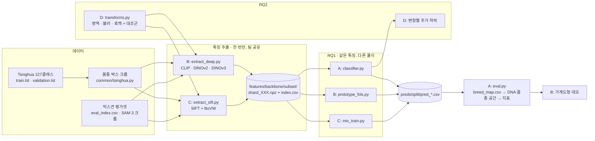

# dog-mix-cv

혼합 시각 범주의 구성 비율 추정: 믹스견 혈통을 사례로 (CV 팀 프로젝트, 4명)

- **RQ1:** 혼합 비율 복원이 특징 종류(SIFT · CLIP · DINOv2 · DINOv3)와 풀이 방식(분류기 · 평균점 섞기 · 섞기 학습)에 따라 어떻게 다른가
- **RQ2:** 그 추정은 어떤 시각 단서(영역 · 질감 · 색)에 기대고, 품종군마다 다른가

## 폴더 구조

```
dog-mix-cv/
├── README.md
├── requirements.txt
├── .gitignore                 # data/, outputs/, *.npz 등은 올리지 않음
├── configs/
│   ├── paths.yaml             # 데이터·출력 경로 (DOGMIX_PATHS 환경 변수로 바꿔 끼울 수 있음)
│   └── backbones.yaml         # 추출기 HF ID, 배치 크기, 샤드 크기
├── src/
│   ├── common/                # 모두가 같이 쓰는 코드
│   │   ├── config.py          #   설정 읽기, 실행 로그(runs.jsonl)
│   │   ├── tsinghua.py        #   분할 파일 읽기, 클래스 제외, 몸통 박스 크롭
│   │   ├── evalset.py         #   평가셋 인덱스(eval_index.csv) 읽기
│   │   ├── features_io.py     #   특징 파일 저장·읽기 (공통 형식, 임시 파일에 쓴 뒤 이름 바꾸기)
│   │   ├── status.py          # [B] 진행 상태 확인 (샤드 · 예측 · 로그)
│   │   └── check_data.py      # [B] 데이터 점검 (경로 · 몸통 박스 · 클래스 수)
│   ├── features/
│   │   ├── backbones.py       # [B] CLIP · DINOv2 · DINOv3 (+ dummy 점검용)
│   │   ├── extract_deep.py    # [B] 딥 특징 추출
│   │   ├── check_models.py    # [B] 모델 점검 (모델 ID · 출력 차원 · 레지스터 토큰)
│   │   └── extract_sift.py    # [C] SIFT + BoVW 추출 (약속만 적힘)
│   ├── rq1/
│   │   ├── classifier.py      # [A] 분류기 (약속만)
│   │   ├── prototype_fcls.py  # [B] 평균점 섞기 (FCLS)
│   │   ├── sanity_mix.py      # [B] 점검 실험: 특징 공간 가짜 믹스의 비율 복원 (평가셋 없이)
│   │   └── mix_train.py       # [C] 섞기 학습 (약속만)
│   ├── rq2/
│   │   └── transforms.py      # [D] 단서 변형 + 대조군 (약속만)
│   ├── eval/
│   │   └── eval.py            # [A] 채점 (약속만)
│   └── demo/
│       └── app.py             # [B] 가계도형 Gradio 데모 (D11–14)
├── scripts/                   # [B] UF 초안 평가셋 준비, 임시 채점
│   ├── provisional_score_uf.py        #   믹스견 Top-1 · Coverage (dev)
│   └── provisional_score_purebred.py  #   순종 Top-1 · Top-5 (val dev 절반)
├── notebooks/
│   └── B_colab_run.ipynb      # [B] Colab 실행 전용 (로직 없음)
└── tests/
    ├── make_toy_data.py       # 가짜 데이터로 전체 흐름 점검
    └── test_fcls.py           # FCLS가 알려진 비율을 되찾는지 확인
```

## 파이프라인



## 공통 약속 (파일 형식)

| 파일 | 형식 | 만드는 사람 |
|---|---|---|
| `eval_index.csv` | `image_id, dog_id, path, split(dev/test)` | A (path는 D의 SAM 3 크롭) |
| 특징 | `features/{backbone}/{subset}/shard_XXX.npz` (`image_id`, `cls`, `mean`) + `index.csv` | B(딥), C(SIFT) |
| 예측 | `preds/{split}/pred_{실행이름}.csv` = `dog_id, split, <Tsinghua 클래스 127개>` (행 합 1, 개 단위). `{split}`은 dev / test / all | A·B·C |
| 로그 | `logs/runs.jsonl` 한 줄 = 실행 하나 (실패도 기록) | 모두 |

- **체크포인트:** 결과는 Drive에 바로 쓴다. 특징 샤드와 예측은 임시 파일(`*.tmp`)에 다 쓴 뒤 이름을 바꿔 저장한다. 같은 명령을 다시 실행하면 끝난 샤드는 건너뛰고, `--skip-existing`이면 이미 있는 예측도 건너뛴다. 진행 상태는 `python -m src.common.status`.
- **클래스 순서:** 학습셋 label의 정렬 순서. 모두 같은 순서를 쓴다.
- **품종 공간:** 예측은 Tsinghua 클래스 공간으로 내고, DNA 품종으로 합치는 일은 `eval.py`가 `breed_map.csv`로 한다.
- **실행 이름:** `RQ-추출기-방법-시드` (예: `RQ1-dinov3-proto-r1`, `RQ1-dinov3-mix-s1`)

## 평가 기준

A의 평가 기준 문서(`EVALUATION_POLICY.md`)를 따른다. 순종과 믹스견은 다른 표로 보고하고 한 숫자로 합치지 않는다.

| | 순종견 | 믹스견 |
|---|---|---|
| 데이터 | Tsinghua validation | UF 평가셋 (dev 20마리, hold 80마리) |
| 지표 | Top-1, 필요 시 Top-5 | Top-1, Coverage, 정답 / 평가 가능 / 전체 |
| 채점 단위 | 사진 1장 | 개 1마리 (얼굴 · 전신 확률 평균) |
| 대표값 | 반복 3회의 확률을 평균한 뒤 채점 | 같음. 반복별 최소~최대도 기록 |

믹스견 Top-1 규칙:

- DNA에 기록된 품종(최대 4개)만 부분 정답으로 쓰고 합을 100으로 보정하지 않는다.
- 정답은 기록된 비율이 가장 큰 품종이다. 동률이면 그중 하나를 맞혀도 정답이다.
- 매핑은 정확 + 유사를 인정한다(기준 문서의 dev 19/20과 일치). 한 품종에 여러 클래스가 연결되면 그중 하나를 맞히면 정답이고, 클래스 확률을 합친 뒤 1위를 뽑지는 않는다.
- 1위 품종이 전부 Tsinghua 범위 밖인 개는 Top-1 분모에서 뺀다. Coverage = 평가 가능한 개 수 / 전체 개 수.
- hold는 모든 설정을 고정한 뒤 마지막에 한 번만 채점한다.

B에 적용할 때:

- 평균점 섞기에는 학습 seed가 없어서 부분 표본 r1 · r2 · r3을 반복 3회로 쓴다.
- D8 전에는 UF dev와 val dev 절반(2,540장)만 쓴다. hold와 val test 절반은 쓰지 않는다.
- B의 채점 스크립트는 평균점 섞기 예측만 읽는 임시 채점이다. 정식 채점은 A의 `eval.py`가 한다.
- 포착 혈통 비율은 보고서 지표로 따로 출력한다. 이 표의 coverage는 개마다의 DNA 비율 합으로, 위의 Coverage와 다른 값이다.

## B 실행 순서 (Colab)

`notebooks/B_colab_run.ipynb`를 위에서부터 실행한다(Drive 연결, 데이터 복사·해제, 경로 설정, 점검, 추출, 평균점 섞기). 노트북이 실행하는 명령은 아래와 같다.

```bash
# 0. 세션 시작: Drive 연결 후 데이터를 /content로 복사해 푼다 (Drive에서 직접 읽으면 느림)
pip install -r requirements.txt
huggingface-cli login            # DINOv3는 접근 승인된 계정으로
python -m src.common.status --logs 5         # 진행 상태 (세션을 다시 열면 여기부터)
python -m src.common.check_data              # 경로 · 몸통 박스 · 클래스 수
python -m src.features.check_models          # 모델 ID · 출력 차원 · 레지스터 토큰

# 1. 1,000장으로 시간 재기 → 장/초로 전체 시간 추정
python -m src.features.extract_deep --backbone dinov3 --subset train --limit 1000 --tag timing
python -m src.common.status --logs 1 --eta

# 2. 학습셋 · val · 평가셋 특징 (끊기면 같은 명령으로 다시 실행 → 이어서 뽑음)
for b in dinov3 dinov2 clip; do
  python -m src.features.extract_deep --backbone $b --subset train
  python -m src.features.extract_deep --backbone $b --subset val
  python -m src.features.extract_deep --backbone $b --subset eval
done

# 3. 평균점 섞기 (dev). L2 정규화 여부를 dev로 비교해 D7에 고정
for b in dinov3 dinov2 clip sift; do
  python -m src.rq1.prototype_fcls --backbone $b --repeats 1 2 3 --split dev --skip-existing
  python -m src.rq1.prototype_fcls --backbone $b --repeats 1 2 3 --split dev --skip-existing --l2
done

# 4. UF dev 평가 (믹스견 Top-1 · Coverage). DRIVE_DIR 은 팀 폴더 경로
#    dna_UF.csv 는 Drive 에 복사하지 않고 /content 에만 둔다 (노트북 셀 10-1 이 만든다)
UF=$DRIVE_DIR/evalset
for b in dinov3 dinov2 clip; do
  python -m src.features.extract_deep --backbone $b --subset eval \
      --eval-index "$UF/eval_index_UF_panels.csv" --save-as eval_uf_panels
  python -m src.rq1.prototype_fcls --backbone $b --repeats 1 2 3 --split dev --eval-subset eval_uf_panels --skip-existing
  python -m src.rq1.prototype_fcls --backbone $b --repeats 1 2 3 --split dev --eval-subset eval_uf_panels --skip-existing --l2
done
python scripts/provisional_score_uf.py --uf-dir "$UF/uf_draft" --dna /content/uf_private/dna_UF.csv
#    참고값(정확 매핑만, 한 품종 고정 기준선)까지 보려면 --reference

# 5. 순종 평가 (val dev 절반, Top-1 · Top-5)
python scripts/make_val_split.py
for b in dinov3 dinov2 clip; do
  python -m src.rq1.prototype_fcls --backbone $b --eval-kind purebred --repeats 1 2 3 --split dev --skip-existing
  python -m src.rq1.prototype_fcls --backbone $b --eval-kind purebred --repeats 1 2 3 --split dev --skip-existing --l2
done
python scripts/provisional_score_purebred.py --uf-dir "$UF/uf_draft"

# 6. D의 변형 이미지 특징 (변형별 인덱스 csv를 받아서)
python -m src.features.extract_deep --backbone dinov3 --subset eval \
    --eval-index /content/drive/MyDrive/cv_dog/evalset/eval_gray_index.csv --save-as eval_gray
```

## 로컬 점검 (모델 다운로드 없이)

```bash
python tests/make_toy_data.py /tmp/toy
python -m tests.test_fcls
export DOGMIX_PATHS=/tmp/toy/paths.yaml
python -m src.features.extract_deep --backbone dummy --subset train
python -m src.features.extract_deep --backbone dummy --subset eval
python -m src.rq1.prototype_fcls --backbone dummy --repeats 1 2 3 --split dev --skip-existing
python -m src.common.status --logs 5
python -m src.common.check_data
python -m src.features.check_models --backbones dummy
```

같은 extract 명령을 한 번 더 실행하면 0장을 뽑고, 같은 prototype_fcls 명령은 `[건너뜀]`을 출력한다.
Windows PowerShell에서는 `export` 대신 `$env:DOGMIX_PATHS = "...\paths.yaml"`을 쓴다.

## 실제 데이터로 처음 돌릴 때 확인할 것

- Tsinghua 주석 폴더 이름과 xml 태그(`bodybndbox`)가 코드와 맞는지. 몸통 박스를 못 찾으면 전체 이미지를 쓴다.
- `configs/backbones.yaml`의 Hugging Face 모델 ID, 그리고 설치된 `transformers`가 DINOv3를 지원하는지.
- 학습셋 클래스 수가 127(dingo 제외 시 126)인지: `features/{backbone}/train/index.csv`의 label 종류 수.
