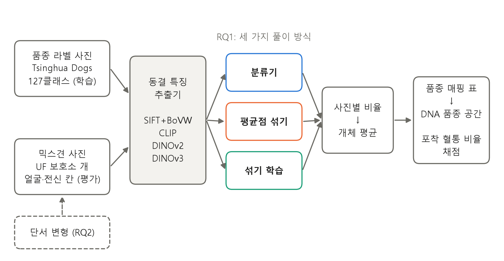

## III. METHOD

<!--
작업 메모 (docx에는 나오지 않는다). 3.1 모델 설명의 출처 (2026-11-24 원문 대조)
- ViT: arXiv 2010.11929 3.1절 식 (1)–(4), 부록 A 식 (5)–(8), 표 1(ViT-Base 12층·768·MLP 3072·헤드 12·86M)
- SIFT: Lowe 2004 1절(4단계), 식 (1)(DoG), 3.2절(옥타브당 3 스케일), 3.3절(σ=1.6), 4절(대비 0.03), 4.1절(r=10), 6.1절(4×4×8=128, 정규화 후 0.2로 자름)
- BoVW: Csurka et al. 2004 2절(4단계, k-평균 어휘, Naive Bayes·SVM, Harris affine 검출기 + SIFT 기술자)
- CLIP: arXiv 2103.00020 2.2절(WIT 4억 쌍), 2.3절·그림 3 의사코드(대칭 교차 엔트로피, 로그 매개변수화한 온도), 2.4절(트랜스포머 앞 층 정규화 추가), 2.5절(τ=0.07로 시작, 로짓 배율 100 이하), 표 20(ViT-B/16: 12층·폭 768·헤드 12, 텍스트 12층·512·헤드 8, 임베딩 512, 입력 224). CLS → 층 정규화 → 편향 없는 선형 투영은 공식 코드(openai/CLIP model.py)와 HF 구현으로 확인. 손실 식은 논문에 수식이 없고 그림 3 의사코드를 옮긴 것
- DINOv2: arXiv 2304.07193v2 3절(LVD-142M, 12억 장 풀, 중복 제거, 질의당 이웃 4장 검색), 4절(DINO·iBOT 손실, 분리된 두 머리, Sinkhorn-Knopp 3회, KoLeo, 518 해상도 적응), 5절(작은 모델은 ViT-g에서 증류), 부록 B.1(KoLeo 가중치 0.1, EMA 모멘텀 0.994→1.0). 합산식 L_DINO + L_iBOT + 0.1 L_KoLeo는 논문에 식으로 나오지 않아 4절과 부록 B.1을 종합한 것. 논문 표 17은 ViT-B/14를 18블록으로 적었지만 공개 가중치(HF facebook/dinov2-base config)는 12층이므로 12층으로 씀. dinov2-base에는 레지스터 토큰이 없음(HF config)
- DINOv3: arXiv 2508.10104v1 3.1절(LVD-1689M, 약 170억 장 풀), 3.2절 식 (1)(L_Pre), RoPE와 RoPE-box jittering, 4.2절 식 (2)(Gram anchoring, 100만 반복 이후, Gram 교사 1만 반복마다 갱신), 식 (3)(L_Ref, 부록 C w_Gram=2), 5.1절(고해상도 적응), 5.2절(고정된 7B 교사에서 증류, Gram 없음), 표 2(ViT-7B 6.7B·40블록·폭 4096·헤드 32·패치 16·레지스터 4), 부록 C(전역 크롭 2장 256, 지역 크롭 8장 112). w_D, w_DK 값은 논문에 없음
- 우리 특징의 차원: CLIP 512·DINOv2 768은 HF config, DINOv3 768은 저장된 특징(outputs/features_drive/dinov3/eval_uf_panels/shard_000.npz)으로 확인. SIFT 128차원은 OpenCV SIFT_create().descriptorSize()
- DINOv3 ViT-B/16의 층 수·헤드 수는 HF 저장소가 승인제라 config를 읽지 못함 → 본문에 쓰지 않음
-->

이 장은 실험의 재료와 절차를 설명한다. III-A절은 특징을 뽑는 기반 모델 4종을, III-B절은 과제의 정의와 데이터를, III-C절은 그 특징 위에서 구성 비율을 추정하는 세 가지 풀이 방식(RQ1)과 시각 단서를 재는 변형 실험(RQ2)을, III-D절은 평가 지표와 통계 절차를 설명한다.

전체 흐름은 그림 1과 같다. 학습 사진과 평가 사진은 모두 동결한 특징 추출기를 한 번만 거쳐 특징 벡터로 저장된다. 세 가지 풀이 방식은 이 특징을 공유하며, 각각 Tsinghua 클래스 공간에서 사진별 구성 비율을 낸다. 사진별 비율은 개체 단위로 평균한 뒤, 품종 매핑 표로 DNA 검사의 품종 공간에 옮겨 채점한다. 특징 추출과 채점 단계가 모든 방법에 공통이므로, 방법 사이의 차이는 풀이 방식에서만 나온다.

**그림 1. 실험 흐름.** 품종 라벨 사진(학습)과 믹스견 사진(평가)은 같은 동결 특징 추출기를 거친다. 세 가지 풀이 방식은 같은 특징에서 Tsinghua 클래스 공간의 구성 비율을 내고, 개체 단위로 모은 비율을 품종 매핑 표로 DNA 품종 공간에 옮겨 DNA 결과와 비교한다.

### A. Models

이미지 특징은 학습 신호가 서로 다른 네 가지 특징 추출기로 얻는다(표 I). SIFT+BoVW는 사람이 설계한 지역 특징을, CLIP은 이미지와 텍스트의 대응으로 학습한 언어 감독 표현을, DINOv2와 DINOv3는 라벨 없이 이미지만으로 학습한 자기지도 표현을 대표한다. 모든 모델은 공개된 가중치를 미세조정 없이 동결한 채로 쓴다. 같은 실험을 네 추출기에서 반복하는 목적은 추출기의 순위를 매기는 것이 아니라, 결론이 특징의 종류에 따라 달라지는지를 확인하는 데 있다. 이 절은 각 추출기의 구조와 사전학습 목적을 차례로 설명하고, 마지막에 우리가 어떤 출력을 특징으로 쓰는지 정리한다.

**표 I. 특징 추출기**

| 추출기 | 학습 신호 | 사전학습 데이터 | 백본 | 우리가 쓰는 특징 (차원) |
|---|---|---|---|---|
| SIFT+BoVW | 없음 (설계 특징) | 없음 (시각 어휘만 학습 사진으로 군집화) | 없음 | 시각 단어 히스토그램 (512) |
| CLIP | 이미지-텍스트 대조 학습 | WIT, 이미지-텍스트 4억 쌍 | ViT-B/16 (12층, 폭 768) | 투영 이미지 임베딩 (512) |
| DINOv2 | 자기지도 (자기 증류 + 가린 패치 예측) | LVD-142M, 1억 4,200만 장 | ViT-B/14 (12층, 폭 768), ViT-g/14에서 증류 | CLS 토큰 (768) |
| DINOv3 | 자기지도 (DINOv2 목적 + Gram anchoring) | LVD-1689M, 16억 8,900만 장 | ViT-B/16, 70억 매개변수 교사에서 증류 | CLS 토큰 (768) |

**공통 구조: 비전 트랜스포머.** 세 딥 모델은 모두 비전 트랜스포머(Vision Transformer, ViT; Dosovitskiy et al., 2021)를 이미지 인코더로 쓴다. ViT는 크기 $H \times W$의 이미지를 $P \times P$ 크기의 겹치지 않는 패치 $N_p = HW/P^2$개로 자르고, 각 패치를 펼친 벡터 $x_p^n \in \mathbb{R}^{P^2 C}$를 선형 사상 $E$로 $D$차원 토큰으로 바꾼다. 이 토큰들 앞에 학습 가능한 분류 토큰(CLS 토큰) $x_{\mathrm{class}}$를 붙이고 위치 임베딩 $E_{\mathrm{pos}}$를 더해 입력 열을 만든다.

$$z_0 = [x_{\mathrm{class}};\, x_p^1 E;\, \dots;\, x_p^{N_p} E] + E_{\mathrm{pos}}, \qquad E \in \mathbb{R}^{(P^2 C) \times D},\ E_{\mathrm{pos}} \in \mathbb{R}^{(N_p + 1) \times D}$$

입력 열은 $L$개의 트랜스포머 블록을 거친다. 각 블록은 층 정규화(LN) 뒤 다중 헤드 자기 주의(MSA)와 다층 퍼셉트론(MLP)을 잔차 연결로 쌓은 구조다.

$$z'_\ell = \mathrm{MSA}(\mathrm{LN}(z_{\ell-1})) + z_{\ell-1}, \qquad z_\ell = \mathrm{MLP}(\mathrm{LN}(z'_\ell)) + z'_\ell, \qquad \ell = 1, \dots, L$$

자기 주의는 각 토큰을 질의 $q$, 키 $k$, 값 $v$로 사상한 뒤, 질의와 키의 유사도로 모든 토큰의 값을 가중 평균한다. 헤드 $h$개를 병렬로 계산하고 이어 붙여 다시 $D$차원으로 사상한다.

$$[q, k, v] = z U_{qkv}, \qquad \mathrm{SA}(z) = \mathrm{softmax}\!\left(\frac{q k^{\top}}{\sqrt{D_h}}\right) v, \qquad \mathrm{MSA}(z) = [\mathrm{SA}_1(z); \dots; \mathrm{SA}_h(z)]\, U_{\mathrm{msa}}$$

여기서 $D_h = D/h$는 헤드 하나의 차원이다. 자기 주의는 모든 토큰 쌍 사이에서 계산되므로, 마지막 층의 CLS 토큰 $z_L^0$은 이미지 전체의 정보를 모은 요약 표현이 된다. 원 논문의 ViT-Base는 $L = 12$, $D = 768$, $h = 12$, MLP 은닉 차원 3,072, 매개변수 약 8,600만 개다. 우리가 쓰는 세 딥 모델은 모두 이 Base 크기다. 패치 크기는 CLIP과 DINOv3가 16, DINOv2가 14이므로, 224×224 입력은 각각 196개와 256개의 패치 토큰이 된다. 세 모델은 이 공통 구조 위에서 무엇을 학습 신호로 삼는지가 다르다.

**SIFT+BoVW.** SIFT(Lowe, 2004)는 영상의 크기와 회전 변화에 불변인 지역 특징이다. 원 논문은 SIFT를 네 단계로 계산한다. 첫째, 척도 공간에서 극값을 찾는다. 영상 $I$를 표준편차가 $\sigma$인 가우시안 $G$로 흐린 $L(x, y, \sigma) = G(x, y, \sigma) * I(x, y)$를 만들고, 인접한 두 척도의 차이인 가우시안 차분(difference of Gaussians, DoG)을 계산한다.

$$D(x, y, \sigma) = \big(G(x, y, k\sigma) - G(x, y, \sigma)\big) * I(x, y) = L(x, y, k\sigma) - L(x, y, \sigma)$$

한 옥타브는 $s$개의 구간으로 나뉘며 $k = 2^{1/s}$이다. 원 논문은 $s = 3$, 시작 척도 $\sigma = 1.6$을 쓴다. 각 화소가 같은 척도와 위아래 척도의 이웃 26개보다 크거나 작으면 키포인트 후보가 된다. 둘째, 후보의 위치를 보간으로 다듬고, 대비가 낮은 후보($|D(\hat{x})| < 0.03$, 화소값을 [0, 1]로 둘 때)와 가장자리를 따라 놓인 후보(헤세 행렬의 주곡률 비가 $r = 10$을 넘는 경우)를 버린다. 셋째, 키포인트 주변 기울기의 방향 히스토그램에서 주된 방향을 정해, 이후 계산을 그 방향 기준으로 한다. 이 단계가 회전 불변성을 준다. 넷째, 키포인트 주변을 4×4 칸으로 나누고 칸마다 기울기 방향을 8개 구간의 히스토그램으로 모아 $4 \times 4 \times 8 = 128$차원 기술자를 만든다. 조명 변화의 영향을 줄이기 위해 기술자를 단위 길이로 정규화하고, 0.2보다 큰 값을 0.2로 자른 뒤 다시 정규화한다.

SIFT는 사진마다 키포인트의 개수가 다르므로 그대로는 고정 길이 특징이 되지 않는다. 시각 단어 가방(bag of visual words, BoVW; Csurka et al., 2004)은 이 문제를 문서 분류의 단어 가방처럼 푼다. 원 논문의 절차는 패치 검출과 기술, 시각 어휘로의 배정, 단어별 빈도 히스토그램 작성, 분류기 학습의 네 단계다. 시각 어휘는 학습 기술자를 k-평균으로 군집화한 중심점들이다. 우리는 이 중 앞의 세 단계만 써서 특징을 만들고, 분류는 III-C절의 풀이 방식에 맡긴다. 학습 사진의 기술자를 군집화해 $V$개의 시각 단어 $\{c_v\}_{v=1}^{V}$를 만든 뒤, 사진 $x$의 기술자 집합 $\mathcal{U}(x)$의 각 기술자를 가장 가까운 시각 단어에 배정하고 빈도를 기술자 수로 나눈다.

$$h_v(x) = \frac{1}{|\mathcal{U}(x)|} \sum_{u \in \mathcal{U}(x)} \mathbb{1}\Big[v = \arg\min_{v'} \lVert u - c_{v'} \rVert_2\Big], \qquad v = 1, \dots, V$$

우리는 $V = 512$로 둔다. Csurka et al.(2004)은 Harris affine 검출기로 패치를 찾았지만, 우리는 SIFT 자체의 DoG 검출기를 쓴다. 이 표현은 시각 어휘의 군집화 외에는 학습을 거치지 않고, 라벨도 쓰지 않는다. 또 흑백 영상에서 계산하므로 지역 질감과 윤곽 정보를 담고 색 정보는 담지 않는다.

**CLIP.** CLIP(Radford et al., 2021)은 이미지 인코더와 텍스트 인코더를 함께 학습해, 짝이 맞는 이미지와 텍스트가 같은 공간에서 가깝게 놓이도록 한 모델이다. 학습 데이터는 인터넷의 공개 자료에서 모은 이미지-텍스트 4억 쌍(WebImageText, WIT)이다. 우리가 쓰는 ViT-B/16 모델에서 이미지 인코더는 ViT-Base(12층, 폭 768, 헤드 12)이고, 텍스트 인코더는 12층, 폭 512, 헤드 8의 트랜스포머다. CLIP의 ViT는 패치 임베딩과 위치 임베딩을 더한 뒤 트랜스포머에 넣기 전에 층 정규화를 한 번 더 한다. 이미지 임베딩은 마지막 층의 CLS 토큰에 층 정규화를 적용하고, 편향 없는 선형 사상 $W_I \in \mathbb{R}^{512 \times 768}$으로 512차원 공통 공간에 투영해 얻는다. 텍스트 임베딩도 같은 512차원 공간으로 투영된다.

학습은 배치 안의 대조 과제로 한다. 크기 $B$의 배치에서 $B$개의 이미지와 $B$개의 텍스트가 이루는 $B^2$개의 쌍 가운데 실제 짝 $B$개를 맞히도록 한다. 투영 후 L2 정규화한 이미지 임베딩 $u_i$와 텍스트 임베딩 $t_j$의 코사인 유사도를 $s_{ij} = u_i^{\top} t_j$라 하면, 손실은 이미지에서 텍스트를 고르는 교차 엔트로피와 텍스트에서 이미지를 고르는 교차 엔트로피의 평균이다. 원 논문은 이 손실을 의사코드(원 논문의 그림 3)로 제시하며, 아래 식은 그것을 수식으로 옮긴 것이다.

$$\mathcal{L}_{\mathrm{CLIP}} = -\frac{1}{2B} \sum_{i=1}^{B} \left[ \log \frac{\exp(s_{ii}/\tau)}{\sum_{j=1}^{B} \exp(s_{ij}/\tau)} + \log \frac{\exp(s_{ii}/\tau)}{\sum_{j=1}^{B} \exp(s_{ji}/\tau)} \right]$$

온도 $\tau$는 로그 척도의 매개변수로 두어 함께 학습한다. 학습은 $\tau = 0.07$에 해당하는 값에서 시작하고, 로짓 배율 $1/\tau$가 100을 넘지 않도록 자른다. 이 목적은 이미지 임베딩이 그 이미지를 설명하는 문장과 가까워지게 만들므로, 이미지 임베딩에는 언어로 설명되는 개념 정보가 담긴다. 우리는 투영 후 정규화하기 전의 512차원 이미지 임베딩을 특징으로 쓴다.

**DINOv2.** DINOv2(Oquab et al., 2024)는 라벨과 텍스트 없이 이미지만으로 학습한 자기지도 모델이다. 학습 데이터 LVD-142M은 1억 4,200만 장으로, 중복을 제거한 약 12억 장의 비선별 이미지 풀에서 여러 선별 데이터셋의 이미지와 가까운 이미지를 검색해 모은 것이다. 검색할 때는 질의 이미지마다 가장 가까운 이웃을 보통 4장씩 가져오고, 거의 같은 이미지와 평가용 벤치마크와 겹치는 이미지는 지운다.

학습은 자기 증류(self-distillation) 방식이다. 같은 구조의 학생 네트워크와 교사 네트워크를 두고, 한 이미지에서 자른 서로 다른 보기(view)에 대해 학생의 출력이 교사의 출력 분포를 따라가도록 학습한다. 교사는 따로 학습하지 않고 학생 매개변수의 지수 이동 평균(EMA)으로 갱신한다.

$$\theta_t \leftarrow m\, \theta_t + (1 - m)\, \theta_s$$

모멘텀 $m$은 코사인 일정으로 0.994에서 1.0까지 올라간다. 목적 함수는 세 항으로 이루어진다. 첫째, 이미지 수준의 DINO 손실은 서로 다른 크롭에서 나온 학생과 교사의 CLS 토큰을 각각 DINO 머리(MLP)에 통과시켜 원형(prototype)에 대한 점수를 얻고, 그 분포를 맞춘다.

$$\mathcal{L}_{\mathrm{DINO}} = -\sum p_t \log p_s$$

여기서 $p_s$는 학생 점수의 소프트맥스이고, $p_t$는 교사 점수를 배치 단위로 중심화한 분포다. DINOv2는 교사의 중심화에 SwAV의 Sinkhorn-Knopp 정규화(3회 반복)를 쓴다. 둘째, 패치 수준의 iBOT 손실은 학생 입력의 패치 일부를 가리고, 가린 위치에서 학생이 낸 분포가 가리지 않은 교사 입력의 같은 위치 패치 분포를 따라가게 한다.

$$\mathcal{L}_{\mathrm{iBOT}} = -\sum_{i} p_{t,i} \log p_{s,i}$$

여기서 $i$는 가린 패치의 위치다. 두 손실은 서로 다른 머리를 쓴다. 셋째, KoLeo 정규화는 배치 안의 특징이 한곳에 몰리지 않고 고르게 퍼지게 한다. L2 정규화한 특징 $x_1, \dots, x_n$에 대해 각 점과 가장 가까운 다른 점 사이의 거리 $d_{n,i} = \min_{j \ne i} \lVert x_i - x_j \rVert$를 키운다.

$$\mathcal{L}_{\mathrm{KoLeo}} = -\frac{1}{n} \sum_{i=1}^{n} \log d_{n,i}$$

원 논문은 KoLeo를 첫 번째 전역 크롭의 CLS 토큰에 가중치 0.1로 적용한다. 세 항을 합치면 아래와 같다. 원 논문에 이 합산식이 그대로 나오지는 않으며, 4절의 설명과 부록 B.1의 가중치를 종합해 적은 것이다.

$$\mathcal{L}_{\mathrm{DINOv2}} = \mathcal{L}_{\mathrm{DINO}} + \mathcal{L}_{\mathrm{iBOT}} + 0.1\, \mathcal{L}_{\mathrm{KoLeo}}$$

학습 끝 무렵에는 짧은 기간 동안 입력 해상도를 518×518로 높여 고해상도에 적응시킨다. DINOv2는 가장 큰 ViT-g/14(약 11억 매개변수)만 이 방식으로 처음부터 학습하고, ViT-B/14를 포함한 작은 모델은 고정한 ViT-g/14를 교사로 삼아 같은 목적으로 증류해 얻는다. 우리가 쓰는 공개 ViT-B/14 가중치는 12층, 폭 768, 헤드 12이고, 학습 가능한 위치 임베딩을 쓰며 레지스터 토큰은 없다. 이 목적은 이미지 전체(DINO 손실)와 패치 하나하나(iBOT 손실)의 표현을 함께 학습시킨다.

**DINOv3.** DINOv3(Siméoni et al., 2025)는 DINOv2의 자기지도 학습을 데이터와 모델 규모에서 크게 늘린 모델이다. 학습 데이터 LVD-1689M은 약 170억 장의 이미지 풀에서 선별한 16억 8,900만 장이다. 교사 모델은 매개변수 약 67억 개의 ViT-7B(40블록, 폭 4,096, 헤드 32, 패치 16)이고, 레지스터 토큰 4개를 둔다. 레지스터 토큰은 패치에 대응하지 않는 추가 토큰으로, 출력의 순서는 CLS 토큰, 레지스터 토큰, 패치 토큰이다.

사전학습 목적은 DINOv2와 같은 세 항으로 이루어진다.

$$\mathcal{L}_{\mathrm{Pre}} = \mathcal{L}_{\mathrm{DINO}} + \mathcal{L}_{\mathrm{iBOT}} + 0.1\, \mathcal{L}_{\mathrm{DKoleo}}$$

여기서 $\mathcal{L}_{\mathrm{DKoleo}}$는 KoLeo를 여러 GPU에 나누어 계산하는 형태다. 학생은 이미지 하나에서 256×256 전역 크롭 2장과 112×112 지역 크롭 8장을 보고, 교사는 전역 크롭만 본다. 위치 정보는 학습 가능한 위치 임베딩 대신 축별 회전 위치 임베딩(axial RoPE)으로 넣는다. 각 패치에 [−1, 1] 범위의 정규화된 좌표를 주고, 두 패치의 상대 위치에 따라 주의 점수를 조정하는 방식이다. 학습 중에는 이 좌표 범위를 [−s, s]($s \in [0.5, 2]$)로 무작위로 늘이거나 줄여(RoPE-box jittering) 해상도와 종횡비 변화에 강하게 만든다.

DINOv3의 핵심 기여는 Gram anchoring이다. 원 논문은 큰 모델을 오래 학습하면 전역 성능은 계속 오르지만 패치 특징의 국소적 일관성이 무너지는 현상을 보고한다. Gram anchoring은 학습 초기의 교사(Gram 교사)가 가진 패치 사이 유사도 구조를 학생이 유지하도록 한다. 학생과 Gram 교사의 L2 정규화된 패치 특징을 쌓은 $P \times d$ 행렬을 각각 $X_S$, $X_G$라 하면 손실은 두 Gram 행렬의 차이다.

$$\mathcal{L}_{\mathrm{Gram}} = \big\lVert X_S X_S^{\top} - X_G X_G^{\top} \big\rVert_F^2$$

이 손실은 특징 자체가 아니라 패치 사이의 유사도만 고정하므로, 개별 패치 특징은 자유롭게 움직일 수 있다. Gram anchoring은 100만 반복 이후의 정제 단계에서 전역 크롭에만 적용하며, Gram 교사는 1만 반복마다 주 교사로 갱신한다. 정제 단계의 목적은 다음과 같고, 원 논문이 밝힌 가중치는 $w_{\mathrm{Gram}} = 2$다.

$$\mathcal{L}_{\mathrm{Ref}} = w_{\mathrm{D}}\, \mathcal{L}_{\mathrm{DINO}} + \mathcal{L}_{\mathrm{iBOT}} + w_{\mathrm{DK}}\, \mathcal{L}_{\mathrm{DKoleo}} + w_{\mathrm{Gram}}\, \mathcal{L}_{\mathrm{Gram}}$$

이어서 512, 768 같은 큰 전역 크롭으로 짧게 더 학습해 고해상도에 적응시킨다. ViT-B/16을 포함한 작은 모델은 고정한 ViT-7B를 교사로 삼아 같은 목적으로 증류해 얻으며, 증류에서는 Gram anchoring을 쓰지 않는다. 원 논문은 교사의 추론을 한 번만 하고 여러 학생이 그 결과를 나눠 쓰는 다중 학생 증류로 이 과정을 효율화했다. 우리가 쓰는 ViT-B/16(약 8,600만 매개변수)은 이렇게 증류한 모델이다.

**우리가 쓰는 특징.** 네 추출기 모두 사진마다 두 가지 특징을 저장한다. 하나는 이미지 전체를 요약하는 전역 특징이고, 다른 하나는 패치 토큰의 평균이다. 전역 특징은 CLIP에서는 투영한 512차원 이미지 임베딩이고, DINOv2와 DINOv3에서는 마지막 층 정규화를 거친 CLS 토큰(768차원)이다. 패치 토큰 평균은 마지막 층의 패치 토큰을 평균한 768차원 벡터이며, DINOv3에서는 레지스터 토큰 4개를 빼고 평균한다. SIFT+BoVW는 두 자리에 같은 히스토그램을 넣는다. 기본 실험에는 전역 특징을 쓰고, 패치 토큰 평균은 보조 분석에만 쓴다. 입력 전처리와 추출 설정은 III-D절에 적는다.

### B. Problem Setup and Data

<!--
작업 메모 (docx에는 나오지 않는다)
- 게시 허가 요청: 요청함, 회신 대기 (본문의 [TBD: 회신 결과]는 회신이 오면 채운다)
- 추가 수집(커뮤니티 게시물 등): 이용 권리 미확인으로 제외. 최종 평가는 UF 97마리만 썼다
- 평가셋 인덱스: 최종 채점(2026-11-26)은 로컬 UF 자료(data/evalset_uf/)의 개체 분할을 썼다. 로컬 인덱스(eval_index_UF_panels.csv)에서는 test를 "hold"(믹스견 77 + 단일 품종 3)로 부르고, 본문은 test로 적는다
- 표 A1, 표 2의 사진 수는 data/TrainValSplit/TrainAndValList/train.lst에서 직접 센 값(2026-11-24)
- 커버리지와 정답 비율: A 최종(A/A/docs/A_METHODOLOGY_FINAL.md, METRICS_FINAL.md, RESULTS_DEV_FINAL.md) 기준. 매핑은 A/A/configs/breed_map.csv의 status=정확만(정확 89, 유사 6, 없음 43행). DNA %는 100으로 나눈 값을 그대로 쓰고, 합이 100이 아니어도(평균 83.7%) 늘리지 않음. dev 평균 커버리지 0.5665. 97마리 전체 값은 hold DNA를 써야 하므로 계산하지 않음
- A의 split.csv는 dev 20 / hold 80(믹스견 77 + 단일 품종 3). 본문의 test가 A의 hold다
- 표 2의 해상도: data/low-resolution 70,432개 파일 중 무작위 1,000장(seed 0), 긴 변 중앙값 480, 최소 160, 최대 1,507 (2026-11-24)
-->

**과제 정의.** 학습 품종 집합을 $\mathcal{B}$($|\mathcal{B}| = K$)라 하자. 개체 $d$의 DNA 검사 결과는 품종별 비율 벡터 $y_d$로 주어지며, 여기에는 $\mathcal{B}$에 없는 품종이 포함될 수 있다. 각 방법은 개체 $d$의 사진 $\{x_{d,i}\}_{i=1}^{n_d}$로부터 구성 비율 $\hat{p}_d \in \Delta^{K-1}$을 추정한다. 사진별 예측을 평균해 개체 예측으로 쓰고, 평가는 개체 단위로 한다. 학습에는 품종 라벨이 하나씩 붙은 사진만 사용하며, 믹스견 사진과 DNA 비율은 학습에 쓰지 않는다. 즉 모든 방법은 단일 품종 사진만으로 혼합 비율을 추정해야 한다.

**품종 공간과 커버리지.** 예측은 Tsinghua Dogs의 클래스 공간에서, 정답은 DNA 검사의 품종 공간에서 정의된다. 두 공간은 품종 매핑 표로 연결하며, 여러 클래스가 한 품종에 대응하면 해당 클래스들의 예측 비율을 합한다(부록 B). 매핑 표에서 "정확"으로 표시한 대응만 쓰고, 품종이 비슷할 뿐 같지 않은 "유사" 대응은 쓰지 않는다. 학습 품종이 개체의 혈통을 덮는 정도는 커버리지 $c_d = \sum_{b \in \mathcal{B}} y_{d,b}$로 나타낸다. $c_d < 1$이면 $\mathcal{B}$ 밖 품종의 몫은 어떤 방법으로도 맞힐 수 없다. 따라서 정답으로 원래 비율 $y_d$와, 학습 품종 안에서 다시 정규화한 비율 $\tilde{y}_{d,b} = y_{d,b} / c_d$($b \in \mathcal{B}$)를 함께 사용한다. 전자는 맞힐 수 없는 몫을 포함한 절대 성능을, 후자는 맞힐 수 있는 범위 안의 성능을 나타낸다. 재정규화 비율은 커버리지가 낮을수록 소수 품종에 크게 좌우되므로, $c_d < 0.5$인 개체는 따로 보고한다.

**학습 데이터.** 학습에는 Tsinghua Dogs의 저해상도판(Low-Resolution; Zou et al., 2020)을 사용한다(표 II). 원본은 130개 클래스, train 65,228장, val 5,200장(클래스당 40장)으로 구성된다. 단일 품종이 아닌 chinese_rural_dog와 집개가 아닌 야생 갯과 2종(dhole, African_hunting_dog)을 제외해 127개 클래스(train 61,592장, val 5,080장)를 사용한다. dingo는 학습 클래스에 포함한다. DNA 검사 결과에는 dingo가 나오지 않으므로 채점에서는 어떤 품종에도 대응하지 않는다. 푸들 계열 4개 클래스(teddy, toy_poodle, miniature_poodle, standard_poodle)는 학습에서는 그대로 두고 채점에서 Poodle 하나로 합친다. 클래스별 사진 수는 부록 A에 정리했다. 원 논문에 따르면 전체 70,428장 가운데 약 46,000장은 중국 세 도시의 사용자가 일상에서 찍어 올린 사진이고, 나머지는 Stanford Dogs(약 18,000장)와 이미지 검색(약 6,000장)에서 보탰다. 사진마다 개 한 마리가 있으며, 몸 전체와 머리의 경계 상자가 주석으로 달려 있다. 저해상도판은 공식 페이지에서 고해상도판과 따로 배포하는 판으로, 원 논문에는 언급이 없다. 입력으로는 데이터셋이 제공하는 몸 경계 상자로 자른 사진을 쓴다. 이 데이터셋의 라벨은 사진을 보고 부여된 것으로 혈통서나 DNA로 확인된 것이 아니므로, 본문에서는 이를 품종 라벨 사진이라 부른다.

**표 II. 사용한 데이터와 분할**

| 항목 | Tsinghua Dogs (Low-Resolution) | UF 믹스견 평가셋 |
|---|---|---|
| 용도 | 학습, 순종 보조 평가 | 믹스견 평가 |
| 정답 | 사진 기반 품종 라벨 (사진당 1개) | DNA 검사 품종 비율 (개체당) |
| 규모 (원본) | 130클래스, train 65,228장, val 5,200장 | 100마리, 사진 100장 |
| 규모 (사용) | 127클래스, train 61,592장, val 5,080장 | 믹스견 97마리, 194장 (얼굴·전신 분할) |
| 분할 | train: 학습 / val: dev 2,540장, test 2,540장 | dev 20마리, test 77마리 |
| 해상도 | 가변, 긴 변 중앙값 480 px¹ | 약 448×195 px |
| 입력 | 몸 경계 상자 크롭 | 얼굴 칸, 전신 칸 |

¹ 무작위 1,000장 표본에서 잰 값.

**믹스견 평가셋.** 평가에는 플로리다 대학교 보호소 의학 프로그램이 공개한 개 품종 식별 자료(UF Shelter Medicine ※)를 사용한다. 이 자료는 보호소 개 100마리의 사진과 DNA 검사 결과를 함께 제공하며, 이 중 97마리가 믹스견, 3마리가 단일 품종이다. 원본 사진은 개체당 한 장(약 448×195 픽셀)으로, 얼굴과 전신이 좌우로 붙어 있다. 이를 얼굴 영역(약 157×183)과 전신 영역(약 259×183)으로 나누어 개체당 두 장을 입력으로 쓴다. 단일 품종 3마리는 평가에서 제외하고 참고로만 본다. 정답 비율은 DNA 결과의 품종명을 품종 매핑 표로 대응시켜 만든다. DNA 비율은 검사 결과의 퍼센트를 100으로 나눈 값을 그대로 쓰며, 보고된 비율의 합이 100%에 못 미쳐도 늘리지 않는다. 학습 품종이 믹스견의 혈통을 덮는 정도는 개체마다 크게 다르다. 커버리지 평균은 dev 20마리에서 0.567, test 77마리에서 0.569다. 이 자료는 해상도가 낮고 개체당 한 장면만 담고 있으며, 검사 회사와 품종 패널이 명시되어 있지 않다 `[확인 필요]`. 자료의 이용 조건에 따라 개별 사진과 개체별 DNA 결과는 공개하지 않고 집계 결과만 보고한다. 이 자료는 평가에만 썼고 학습에는 쓰지 않았으며, 사진과 DNA 결과를 공개 코드 저장소(GitHub)나 데모에 올리지 않는다(부록 D). 보고서에 이 자료를 쓰는 데 대해 자료 제공처에 허가를 요청했다 `[TBD: 회신 결과]`.

**순종 보조 평가.** 믹스견 평가셋은 규모가 작고 커버리지가 낮은 개체가 많으므로, 단일 품종 입력에 대한 동작을 보조 평가로 확인한다. Tsinghua val 5,080장을 클래스별로 절반씩 나눠(시드 1) dev 2,540장과 test 2,540장을 만들고, 세 방법 모두 같은 dev 2,540장에서 Top-1 정확도를 잰다. 이 결과는 믹스견 결과와 별도로 보고한다.

**데이터 분할.** 분할은 표 II와 같다. 믹스견 97마리 중 20마리를 무작위로 뽑아 dev로 두고(시드 1), 나머지 77마리를 test로 둔다. 분할은 개체 단위로 하여 한 개체의 두 사진이 같은 분할에 속하게 한다. 방법별 설정은 dev에서만 정하고, test는 설정을 고정한 뒤 한 번만 평가한다(III-D절).

### C. Methods

<!--
작업 메모 (docx에는 나오지 않는다). 설정 값의 출처 (2026-11-24 확인)
- 분류기(A): A/A/docs/A_METHODOLOGY_FINAL.md(최종), A/A/scripts/train_from_feature_zips.py (sklearn MLPClassifier, hidden 없음 = 선형 + 소프트맥스, Adam 1e-3, alpha 1e-4, batch 1024, max 30 epoch, early stopping 10%, n_iter_no_change 5, tol 1e-4, compute_sample_weight balanced, L2 정규화). 온도 보정 없음
- 평균점 섞기(B): B/src/rq1/prototype_fcls.py
- 섞기 학습(C): C/code/deep_mix_train.py (k 2~4, Dirichlet α=1, N_MIX 20,000/에폭, 순종 원-핫 포함, z-score, nn.Linear, AdamW 3e-3, wd 1e-4, 20 에폭, batch 512, soft-target CE), 단일 라벨 대조 C/code/ablation_purebred.py
- 단서 변형(D): D/scripts/build_d_notebook.py(설계: SAM 3, 몸 상자 +10% 여백 크롭, 중앙값 채우기, σ=r·min(H,W), 커널 2⌈3σ⌉+1, PSNR 맞춘 노이즈, 같은 면적 무작위 마스크), run_d_experiment.py(D의 첫 dev 실행: GrabCut 대체, A 분류기 CLIP·DINOv2만). 최종 실행은 B/scripts/final_rq2.py(SAM 3 마스크, 사진 전체, 개 상자 기준 블러 추가, 딥 3종 A 분류기 + SIFT v3 C 섞기 학습). 품종군 분석은 하지 않기로 함(2026-11-26)
- 결합 · 특징 종류 점검(B): B/scripts/combo_analysis_dev.py, improve_eval.py(후보 고정, 대리 지표: val_sub 순종 Top-1 + 가짜 믹스 k 2~3 · α=1 · 1,000개 · 시드 0), improve_from_shards.py(학습셋 전체)
- 섞기 학습 보강(2026-11-25, C/methodology_C.md 반영): 표준화 후 섞기(C/code/deep_mix_train.py 35–37행), 에폭당 순종 전체 + 가짜 믹스 20,000개, 총 3,200단계 · 대조 2,420단계(C/docs/experiment_log_RQ1.csv)
- 학습률 선택(2026-11-25 C 답변, 사용자 전달): SIFT 시드 1에서 1e-3 · 3e-3 · 1e-2 비교, 순종 val 전체(분할 전) Top-1로 3e-3 선택, 딥 3종에 그대로 적용, UF는 안 씀. C는 val 장수를 5,200장으로 적었으나 127클래스 val은 5,080장이라 본문에 장수를 쓰지 않음. 근거: 드라이브 체크포인트 RQ1-sift-mix-s1.pt(1e-2)와 RQ1-sift-mix-s1-lr3e-3.pt가 3분 간격 저장. 초기 1e-3은 표준화 없이 val Top-1 2.7%
-->

#### 1) Proportion Estimators

RQ1에 답하기 위한 세 가지 풀이 방식은 모두 III-A절의 동결 특징 $f \in \mathbb{R}^{D}$를 입력으로 받아, Tsinghua 클래스 공간의 비율 벡터 $\hat{p} \in \Delta^{K-1}$을 낸다. 세 방법은 품종 라벨 사진에서 혼합 비율로 넘어가는 가정이 서로 다르다. 분류기는 단일 품종 분류 확률이 혼합 비율도 반영한다고 보고, 평균점 섞기는 믹스견의 특징이 부모 품종 평균의 볼록 결합이라고 보며, 섞기 학습은 특징 공간에서 만든 가짜 믹스로 그 대응을 직접 학습한다.

**분류기.** 분류기(classifier)는 L2 정규화한 특징 $\bar{f} = f / \lVert f \rVert_2$ 위에 선형 층 하나를 학습하고, 추론 시 소프트맥스 확률을 그대로 구성 비율로 읽는다.

$$\hat{p} = \mathrm{softmax}(W\bar{f} + b), \qquad W \in \mathbb{R}^{K \times D}$$

학습 사진 $\{(f_i, y_i)\}_{i=1}^{N}$에 대해 클래스 불균형을 보정한 가중 교차 엔트로피와 L2 벌점을 최소화한다.

$$\mathcal{L}_{\mathrm{clf}} = -\frac{1}{N} \sum_{i=1}^{N} \omega_{y_i} \log \hat{p}_{i, y_i} + \alpha \lVert W \rVert_2^2, \qquad \omega_c = \frac{N}{K N_c}$$

여기서 $N_c$는 클래스 $c$의 학습 사진 수이고 $\alpha = 10^{-4}$이다. 최적화는 Adam(학습률 $10^{-3}$, 배치 1,024)으로 최대 30에폭 동안 하며, 학습셋의 10%를 검증용으로 떼어 손실이 5에폭 연속 $10^{-4}$ 이상 줄지 않으면 멈춘다. 온도 보정은 하지 않는다. 특징 추출기마다 시드 1, 2, 3으로 학습해 분류기 12개를 만든다. 이 방법은 단일 품종 분류만 배운 확률이 혼합 비율로도 읽히는지를 본다.

**평균점 섞기.** 평균점 섞기(prototype unmixing)는 학습을 하지 않는다. 품종 $k$의 평균점은 그 클래스 학습 사진 특징의 평균 $\mu_k = \frac{1}{|S_k|}\sum_{i \in S_k} f_i$이고, 평균점을 행으로 쌓은 행렬을 $M = [\mu_1, \dots, \mu_K]^{\top} \in \mathbb{R}^{K \times D}$라 하자. 평가 사진의 특징 $f$를 평균점들의 볼록 결합으로 가장 잘 근사하는 가중치를 구한다.

$$\hat{w} = \arg\min_{w} \lVert f - M^{\top} w \rVert_2^2 \quad \text{s.t.}\quad w \ge 0,\ \mathbf{1}^{\top} w = 1$$

이 문제는 초분광 영상의 선형 언믹싱에서 쓰는 FCLS(fully constrained least squares)와 같다(Heinz & Chang, 2001). 원 논문은 비음수 조건과 합 1 조건을 함께 풀기 위해, 끝원소 행렬과 관측 벡터에 작은 상수 $\delta$(원 논문의 실험에서는 $10^{-5}$)를 곱하고 그 아래에 $\mathbf{1}^{	op}$과 1을 덧붙인 뒤 비음수 최소제곱을 푼다. 이렇게 하면 합 1 조건의 행이 상대적으로 $1/\delta$배 큰 가중을 받는다. 우리는 이와 같은 효과를 내도록, 합 1 행에 큰 가중치를 곱한 형태로 비음수 최소제곱(NNLS) 문제를 구성한다.

$$\hat{w} = \arg\min_{w \ge 0} \left\lVert \begin{bmatrix} M^{\top} \\ \delta\, \mathbf{1}^{\top} \end{bmatrix} w - \begin{bmatrix} f \\ \delta \end{bmatrix} \right\rVert_2^2, \qquad \delta = 10 \max_{k,d} |M_{kd}|$$

풀이 후 $\hat{w}$를 그 합으로 나눠 합이 정확히 1이 되게 하고, 이를 $\hat{p}$로 쓴다. 기하학적으로 $\hat{p}$는 $K$개의 평균점이 이루는 단체(simplex) 위에서 $f$에 가장 가까운 점의 무게중심 좌표다. 평균점은 학습셋으로만 만들며, 순종 보조 평가에서는 평균점 재료에 val 사진이 섞이지 않았는지 실행마다 확인한다. 이 방법에는 학습 시드가 없으므로, 품종마다 학습 사진의 80%를 무작위로 뽑아 평균점을 다시 만드는 일을 3번 반복해(시드 1, 2, 3) 평균점 추정의 변동을 잰다. 특징은 L2 정규화하지 않는다. dev에서 L2 정규화를 켜도 모든 지표의 차이가 0.003 이하였다(IV-A절). 각 사진의 상대 근사 오차 $e = \lVert f - M^{\top}\hat{w} \rVert_2 / \lVert f \rVert_2$도 기록한다. 이 값은 입력이 평균점들로 얼마나 설명되는지를 나타내며, 채점에는 쓰지 않고 결과물의 신뢰도 표시 후보로만 쓴다(V장).

**섞기 학습.** 섞기 학습(mixture training)은 특징 공간에서 가짜 믹스를 만들어, 혼합 비율을 직접 예측하도록 학습한다. 가짜 믹스 하나는 다음 순서로 만든다. 먼저 품종 수 $k$를 $\{2, 3, 4\}$에서 고르게 뽑고, 서로 다른 품종 $c_1, \dots, c_k$를 뽑는다. 각 품종에서 학습 사진 특징 $f_j$를 하나씩 뽑고, 대칭 디리클레 분포에서 비율 $\lambda \sim \mathrm{Dir}(\mathbf{1}_k)$를 뽑아 특징과 정답을 만든다.

$$\tilde{f} = \sum_{j=1}^{k} \lambda_j f_j, \qquad t_c = \sum_{j=1}^{k} \lambda_j\, \mathbb{1}[c = c_j]$$

모델은 분류기와 같은 선형 층 $\hat{p} = \mathrm{softmax}(W\tilde{f} + b)$이고, 비율 $t$를 목표로 한 교차 엔트로피를 최소화한다.

$$\mathcal{L}_{\mathrm{mix}} = -\sum_{c=1}^{K} t_c \log \hat{p}_c$$

이 손실은 $t$와 $\hat{p}$ 사이의 KL 발산과 상수만큼 다르므로 기울기가 같다. 입력 특징은 학습셋의 평균과 표준편차로 먼저 표준화하고, 가짜 믹스는 표준화한 특징 공간에서 만든다.

$$z = \frac{f - \mu_{\mathrm{train}}}{\sigma_{\mathrm{train}} + 10^{-6}}$$

검증 사진과 평가 사진에도 학습셋의 통계를 그대로 적용하고, 검증이나 평가 사진의 통계는 쓰지 않는다. 에폭마다 가짜 믹스 20,000개를 새로 만들어, 원-핫 정답을 단 단일 품종 학습 사진 전체와 한데 섞어 학습한다. 단일 품종을 가리는 능력을 유지하면서 비율 분해를 배우게 하려는 것이다. 최적화는 AdamW(학습률 $3 \times 10^{-3}$, 가중치 감쇠 $10^{-4}$, 배치 512, 20에폭)로 하며, 에폭당 약 160단계, 모두 3,200단계다. *학습률은 SIFT+BoVW 특징, 시드 1에서 $10^{-3}$, $3 \times 10^{-3}$, $10^{-2}$를 비교해 순종 val의 Top-1이 가장 높은 $3 \times 10^{-3}$을 골랐고, 이 값을 딥 특징 세 가지에 추출기별 조정 없이 그대로 썼다. 선택 당시 val은 dev와 test로 나누기 전이어서 val 전체의 Top-1을 봤다. 믹스견 사진은 학습률 선택에 쓰지 않았다.* 품종 수 범위, 디리클레 매개변수, 에폭당 가짜 믹스 수는 탐색하지 않은 고정값이다. 특징 추출기마다 시드 1, 2, 3으로 학습해 모델 12개를 만든다.

섞기 학습은 분류기와 구조가 같지만 입력 정규화와 최적화 설정이 다르다. 그래서 학습 목표만의 효과는, 같은 설정에서 가짜 믹스 없이 단일 품종 사진의 원-핫 정답으로만 학습한 대조 모델(단일 라벨 대조, 추출기마다 시드 3개)과 비교해 따로 확인한다. 대조 모델은 가짜 믹스가 빠지므로 모두 2,420단계를 학습해 섞기 학습보다 학습량이 적다. 따라서 섞기 학습이 대조 모델보다 낮게 나오더라도 학습량 부족으로 설명할 수 없다.

**개체 단위 예측과 반복.** 세 방법 모두 사진마다 비율을 낸 뒤, 같은 개체의 얼굴 칸과 전신 칸 예측을 평균하고 합이 1이 되게 다시 나눠 개체의 구성 비율 $\hat{p}_d$로 쓴다. DNA 품종으로 합치는 일은 채점 단계에서 품종 매핑 표로 한다(III-B절). 분류기와 섞기 학습은 시드 1, 2, 3으로, 평균점 섞기는 부분 표본 3회로 반복한다. 채점에 쓰는 대표 예측은 세 반복의 개체별 비율을 평균해 만든다.

**결합과 특징 종류 점검.** 연구 질문의 판정과 별도로, 공식 설정을 바꿀 근거가 있는지 dev에서 두 가지를 점검한다. 후보는 실행 전에 정해 두고, 점검 결과는 결론에 쓰지 않는다. 첫째, 결합 모델은 딥 특징 3종과 세 방법으로 이루어진 9개 설정의 개체 예측을 같은 가중치로 합친다. 합치는 방식은 산술 평균, 기하 평균, 순위 합산, 상위 3개 투표의 네 가지이고, 이를 방법별, 추출기별, 9개 전체의 묶음에 적용한다. 결합이 낼 수 있는 몫의 상한으로, 개체마다 9개 설정 가운데 가장 좋은 것을 고르는 오라클 점수도 계산한다. dev로 후보를 고르는 과정의 낙관을 빼기 위해, 한 마리씩 빼고 나머지 19마리로 후보 중 최고를 고른 뒤 뺀 개체에서 채점하고(leave-one-out), 개체를 복원 추출한 2,000회에서 결합이 같은 표본의 단일 최고 설정을 이기는 비율을 낸다. 둘째, 특징 종류는 전역 특징(CLS), 패치 토큰 평균, 둘을 각각 L2 정규화해 이어 붙인 특징의 세 가지를 비교한다. 세 방법은 III-C절과 같은 설정으로 학습셋 전체에서 다시 학습하고, 학습셋 일부(품종당 30장)로도 같은 비교를 해 학습셋 크기에 따른 변동을 본다. 믹스견을 쓰지 않는 대리 지표로 설정을 고를 수 있는지도 본다. 대리 지표는 검증 사진의 순종 Top-1과, 검증 사진 특징 2~3개를 디리클레 비율로 섞은 가짜 믹스 1,000개에서 잰 포착 혈통 비율이다. 두 점검 모두 시험 시 증강은 쓰지 않으며, 비교는 개체 단위 짝 차이 ± 2SE로 한다(III-D절). 결합이 도움이 될 여지는 예측이 실패하는 단계를 나눠 따로 본다. 개체의 DNA 혈통을 DNA 미보고, 학습 품종 밖, 그리고 정확 매핑된 품종의 예측 순위(DNA 품종 공간에서 1~3위, 4~10위, 11~30위, 31위 이하)로 나누고, 정확 매핑된 혈통마다 9개 설정 가운데 몇 개가 포착했는지를 센다. 풀이 방식의 영향을 빼기 위해, DINOv2 특징과 학습셋 품종 평균점의 코사인 유사도만으로 매긴 순위로 같은 분해를 얼굴 칸과 전신 칸에 대해 따로 계산한다.

#### 2) Cue Perturbation

RQ2는 평가 사진에서 한 가지 시각 단서를 없앤 뒤 같은 방법으로 다시 예측해, 점수가 얼마나 떨어지는지를 잰다. 단서는 영역, 질감, 색의 세 가지이고, 변형은 한 번에 하나만 적용한다(표 III).

**영역.** 개의 몸 마스크와 머리 마스크는 SAM 3(Carion et al., 2026)에 각각 "dog"와 "dog head"를 텍스트 프롬프트로 주어 만든다. 점수가 가장 높은 마스크와 차이가 0.15 이내인 마스크를 최대 5개까지 합치고, 머리 마스크는 몸 마스크 안으로 제한한다. test 개체 한 마리는 얼굴 칸에서 머리 상자를 손으로 그렸다. 변형은 칸으로 나누기 전의 사진 전체(얼굴과 전신이 붙은 원본)에 적용해, 영역을 맥락 속에서 지울 수 있게 한다. RQ1은 두 칸의 예측을 평균하지만 RQ2는 사진 전체 하나를 입력으로 쓴다. 영역 변형은 머리, 몸(머리 제외), 배경 가운데 하나만 남기고 나머지를 사진의 중앙값 색으로 채운다. 모든 변형 사진은 몸 경계 상자에 10% 여백을 더한 영역으로 자른다.

**질감.** 가우시안 블러를 4단계로 건다. 표준편차는 사진의 짧은 변에 대한 비율 $r \in \{0.01, 0.03, 0.06, 0.12\}$로 정한다. 두 번째 세트는 같은 비율을 개 경계 상자의 짧은 변에 적용해, 블러가 사진이 아니라 개의 크기에 맞춰지게 한다.

$$\sigma = \max\big(0.5,\ r \cdot \min(H, W)\big), \qquad \text{커널 크기} = 2\lceil 3\sigma \rceil + 1$$

**색.** 사진을 흑백으로 바꾼 뒤 세 채널에 같은 값을 넣는다.

**대조군.** 변형은 단서를 없애는 동시에 사진 자체를 망가뜨린다. 그래서 변형마다 같은 정도로 사진을 망가뜨리되 해당 단서는 남기는 대조군을 둔다. 블러와 흑백의 대조군은 원본에 가우시안 노이즈를 더한 사진으로, 노이즈의 크기는 변형 사진과 원본 사이의 평균제곱오차(MSE)와 같아지도록, 즉 PSNR이 같아지도록 정한다.

$$\mathrm{PSNR} = 10 \log_{10} \frac{255^2}{\mathrm{MSE}}$$

영역 변형의 대조군은 같은 수의 무작위 화소만 남기고 나머지를 같은 방식으로 채운 사진이다. 대조군의 난수는 사진과 조건마다 고정한다. 개체마다 변형 12장과 대조군 12장, 원본 1장으로 25장을 만든다.

**표 III. 단서 변형과 대조군**

| 단서 | 변형 | 대조군 |
|---|---|---|
| 영역 | 머리만 / 몸만 / 배경만 남김 | 같은 수의 무작위 화소 |
| 질감 | 가우시안 블러 4단계 × 2 (σ = 사진 또는 개 상자 짧은 변의 1, 3, 6, 12%) | 같은 PSNR의 가우시안 노이즈 |
| 색 | 흑백 변환 | 같은 PSNR의 가우시안 노이즈 |

**추가 하락.** 단서 의존도는 변형의 하락에서 대조군의 하락을 뺀 추가 하락(excess drop)으로 잰다.

$$\Delta_{\mathrm{excess}} = (S_{\mathrm{orig}} - S_{\mathrm{pert}}) - (S_{\mathrm{orig}} - S_{\mathrm{ctrl}}) = S_{\mathrm{ctrl}} - S_{\mathrm{pert}}$$

여기서 $S$는 III-D절의 주 지표다. 추가 하락이 양수이면 그 단서를 없앴을 때 사진 손상만으로 설명되지 않는 하락이 있다는 뜻이다. 추가 하락은 개체마다 계산해 개체 평균 ± 2SE로 보고하고, 구간이 0을 포함하면 판단 불가로 적는다. 추출기 4개에 변형 12개로 보정 없이 48번 비교하므로 우연만으로도 두 개 정도는 구간이 0을 벗어난다. 그래서 추출기나 블러 강도를 가로질러 반복되는 양상만 읽는다.

**풀이 방식.** 딥 특징 3종은 RQ1의 분류기를 시드 3개로 그대로 쓴다. SIFT+BoVW는 변형 사진을 학습 특징과 같은 시각 단어로 나타내야 하므로, 저장된 어휘로 다시 추출한 특징(수정판) 위의 섞기 학습(시드 3개)을 쓴다. 이는 RQ1의 공식 SIFT+BoVW 특징과 다르다(IV-A절). 점수는 시드 3개의 예측을 평균한 뒤 채점한다.

**점검.** 파이프라인은 두 가지로 점검한다. dev에서 우리 구현은 팀의 첫 RQ2 실행 경로가 만든 변형 사진을 그대로 재현한다(280장의 PSNR이 모두 같음). SIFT+BoVW는 흑백 영상에서 계산하므로 흑백 변형의 점수가 원본과 같아야 하며, dev와 test의 모든 개체에서 실제로 같았다.

### D. Evaluation Setup

<!--
작업 메모 (docx에는 나오지 않는다)
- 이 절은 A 최종 평가 정의(A/A/docs/METRICS_FINAL.md, A_METHODOLOGY_FINAL.md)를 따른다 (2026-11-24 반영). A 쪽 근거는 A/A/만 쓴다(바깥 A/는 옛 정리본)
- 분류기에는 온도 보정이 없다(A/A/docs/A_METHODOLOGY_FINAL.md 3절)
- 반복: 시드 3개의 개체별 확률을 평균한 뒤 채점한 값이 대표값, 시드별 최소~최대 범위를 함께 보고(A/A/src/eval.py:260)
- 찍기 대비: 개체 단위 짝 차이 평균 ± 2SE(A/A/scripts/evaluate_dev_ratio_metrics.py:256-261). 부트스트랩은 A 최종 문서에 없어 뺐다
- 방법 간 비교: 개체 단위 짝 차이 평균 ± 2SE, 네 추출기 모두(B/scripts/compare_rq1_dev.py → B/results/dev_rq1_paired.csv). Holm 보정 · DINOv3 확인적 검정 · 짝 섞기 1,000회 우연 점검은 구현한 코드가 없어 뺐다 (2026-11-24, 사용자 지시: 코드 기준으로 적기)
- RQ2 최종(2026-11-26): B/scripts/final_rq2.py. 추가 하락은 개체별 차이(대조군 − 변형)의 평균 ± 2SE(outputs/final_rq2/hold/extra_drop_hold.csv). D의 첫 실행 경로(D/scripts/run_d_experiment.py)의 부트스트랩 구간은 최종 보고에 쓰지 않음
- SIFT: 히스토그램을 합 1로 나눈 뒤 제곱근(C/code/make_uf_features.py:39-40). 학습 특징도 모든 행의 L2 노름이 1(sift_all_v2.npy 확인)이라 같은 변환과 맞음
- KL 발산은 A 최종에서 쓰지 않으므로 본문에서 뺐다. 혈통 구간별 재현율과 보정도 A 최종 보고 항목에 없어 뺐다
- 상위 3개는 같은 DNA 품종으로 묶이는 클래스 확률을 합친 뒤 고른다(evaluate_dev_ratio_metrics.py:177, 183). Top-1 예측은 합치기 전 127클래스의 1위
-->

**주 지표.** 주 지표는 포착 혈통 비율(captured ancestry share)이다. 개체 $d$에서 예측 비율이 가장 큰 품종 3개의 집합을 $T_d$라 할 때, 개체 점수와 평가셋 점수는 다음과 같다.

$$s_d = \sum_{b \in T_d} y_{d,b}, \qquad S = \frac{1}{|\mathcal{D}|} \sum_{d \in \mathcal{D}} s_d$$

상위 3개는 같은 DNA 품종에 대응하는 Tsinghua 클래스의 비율을 먼저 합한 뒤에 고른다. 주 지표는 원래 비율 $y_d$로 계산한다. 따라서 $s_d$는 개체의 전체 혈통 가운데 예측이 포착한 몫이며, 학습 품종 밖의 혈통은 어떤 방법으로도 포착할 수 없다. 이 점을 함께 읽을 수 있도록 평가셋의 평균 커버리지 $\bar{c} = \frac{1}{|\mathcal{D}|} \sum_{d} c_d$를 주 지표 옆에 항상 적는다. 이 지표는 비율의 정확한 값보다 어떤 품종이 들어 있는지를 먼저 묻는다. 그래서 방법마다 예측 분포가 뾰족한 정도가 달라도 같은 눈금으로 비교할 수 있고, 사람이 품종 몇 개를 고르는 조사와도 형태가 같다. 다만 사람 대상 조사(MuttMix)의 집계 방식이 우리 정의와 같은지는 확인하지 못했으므로, 그 수치와 우리 결과를 직접 비교하지 않는다 `[확인 필요: MuttMix 원문의 집계 방식]`.

**보조 지표.** 보조 지표는 세 가지다. 첫째는 재정규화 비율 $\tilde{y}_d$로 계산한 포착 혈통 비율로, 학습 품종으로 맞힐 수 있는 범위 안에서의 성능을 나타낸다. 정확 매핑된 혈통이 하나도 없는 개체는 여기서 빼고 그 수를 적는다. 이 값을 전체 혈통의 복원율로 읽지 않는다. 둘째는 분포 겹침 $O_d = \sum_{b} \min(\hat{p}_{d,b}, \tilde{y}_{d,b})$로, 예측 분포와 재정규화한 정답 분포가 겹치는 질량이다. 품종을 찾았는지뿐 아니라 비율의 크기까지 반영하며, 두 분포가 같으면 1이다. 셋째는 Top-1 일치다. 정답은 학습 품종 밖의 품종까지 포함한 전체 DNA 결과에서 정한다. 먼저 비율이 가장 큰 품종을 찾되 공동 1위이면 모두 남기고, 그중 정확 매핑된 Tsinghua 클래스의 합집합을 정답 집합으로 둔다. 예측은 품종 공간으로 합치기 전 127개 클래스 확률의 1위 클래스이며, 이것이 정답 집합에 들면 일치로 센다. 공동 1위 품종이 모두 학습 품종 밖이면 그 개체는 분모에서 빼고, 더 낮은 비율의 학습 품종을 정답으로 올리지 않는다. 그래서 Top-1 일치에는 평가 가능한 개체의 비율(Top-1 평가 가능 비율)을 함께 적는다. KL 발산은 쓰지 않는다. 순종 보조 평가에서는 Top-1 정확도를 보고한다. 판정은 주 지표로만 한다.

**기준.** 결과표에는 두 가지 기준을 항상 함께 적는다. 찍기(prior baseline)는 사진을 보지 않고 학습셋의 품종 빈도 $\pi_b = N_b / N$를 모든 개체에 같은 예측으로 낸 점수로, 지표의 바닥을 나타낸다. 상한(upper bound)은 학습 품종 가운데 실제 비율이 가장 큰 3개를 골랐을 때의 점수 $\frac{1}{|\mathcal{D}|}\sum_d \max_{|T| = 3,\, T \subseteq \mathcal{B}} \sum_{b \in T} y_{d,b}$로, 학습 품종 범위 안에서 어떤 방법이 낼 수 있는 최댓값이다. 커버리지가 낮은 개체가 많을수록 상한은 1보다 크게 낮아진다.

**실험 절차.** 각 방법의 설정(평균점 섞기의 L2 정규화 여부 등)은 dev에서만 정한다. 설정을 고정한 뒤 의사결정 기록에 남기고, test는 설정마다 한 번만 채점한다. dev 점수는 방법 안의 설정을 고르는 데만 쓰고, 추출기나 방법을 골라 결론을 내는 데 쓰지 않는다. test 점수를 본 뒤에는 설정을 바꾸지 않으며, test에서는 추출기와 풀이 방식의 12개 조합을 모두 보고한다. 결과물에 쓸 대표 설정은 test 채점 뒤 팀이 정하므로, 확인적 결론이 아니라 기술적 선택이다. 이 공식 채점 전에 팀원 두 명이 이전 품종 매핑과 실행 경로로 test 분할을 한 번 채점한 적이 있으나, 그 실행으로 여기 보고한 설정을 바꾸지는 않았다.

**통계 절차.** 분류기와 섞기 학습은 시드 3개로, 평균점 섞기는 부분 표본 3회로 반복한다. 대표값은 세 반복의 개체별 비율을 평균한 예측으로 채점한 점수이고, 반복에 따른 안정성은 반복별 점수의 최소~최대 범위로 보고한다. 찍기와의 비교는 개체마다 두 점수의 차이를 구해 그 평균과 표준오차의 2배(±2SE)로 나타내며, 이 구간이 0을 포함하면 "판단 불가"로 적는다. 비율로 나타나는 Top-1 일치에는 Wilson 점수 구간(Wilson, 1927)으로 95% 구간을 붙인다. RQ1의 방법 간 비교도 같은 방식으로 한다. 추출기마다 두 방법의 개체별 점수 차이를 구해 평균 ± 2SE로 나타내고, 구간이 0을 포함하면 "판단 불가"로 적는다. 이 비교는 네 추출기 모두에서 계산한다. 다중 비교 보정과 p값은 쓰지 않으며, 그래서 구간이 0을 겨우 벗어난 비교 하나만으로 방법의 우열을 주장하지 않는다. RQ2의 추가 하락도 개체별 차이(대조군 − 변형)의 평균 ± 2SE로 나타낸다.

**추출기 일관성.** 같은 비교를 추출기마다 반복하고 차이의 부호를 본다. 믹스견 비교에서는 SIFT+BoVW 평가 특징의 문제(IV-A절)로 딥 특징 세 가지만 쓴다. 비교한 추출기의 부호가 모두 같으면 결과를 "일관"으로, 다르면 "추출기 의존"으로 보고한다. 특정 추출기 하나의 결과로 결론을 내지 않는다.

**구현.** 딥 모델은 각자의 기본 Hugging Face 전처리기와 정규화를 쓴다. CLIP과 DINOv2는 짧은 변을 각각 224, 256픽셀로 맞춘 뒤 224×224로 중앙 크롭하고, DINOv3는 가로세로 비율을 유지하지 않고 224×224로 바로 크기를 바꾼다. SIFT+BoVW는 몸 경계 상자 크롭을 흑백 336×336으로 바꾼 뒤 OpenCV의 SIFT로 기술자를 뽑고, 학습 사진 20,000장의 기술자를 미니배치 k-평균으로 군집화해 512개의 시각 단어를 만든다. 사진마다 기술자를 가장 가까운 시각 단어에 배정해 히스토그램을 만들고, 합이 1이 되게 나눈 뒤 제곱근을 취한다(Hellinger 변환). 세 방법은 같은 SIFT+BoVW 특징을 쓴다. 다만 학습 특징을 만들 때 저장된 어휘를 다시 군집화해, 믹스견 평가 사진의 특징이 학습 특징과 다른 어휘로 만들어졌다(IV-A절). 이 때문에 SIFT+BoVW의 믹스견 결과는 해석하지 않는다. 세 방법의 공식 결과는 모두 수정 전 특징으로 계산하며, 저장된 어휘로 학습 특징을 다시 추출한 수정판은 오류의 영향을 확인하는 데에만 쓴다. 모든 실험은 Colab의 T4 GPU 한 장에서 실행했고, DINOv3 기준으로 딥 특징 추출은 초당 약 130~156장, 학습셋 전체에 약 9분이 걸렸다. 사용한 가중치, 실행 이름, 로그 형식, 재현 절차는 부록 C와 D에 정리했다.
