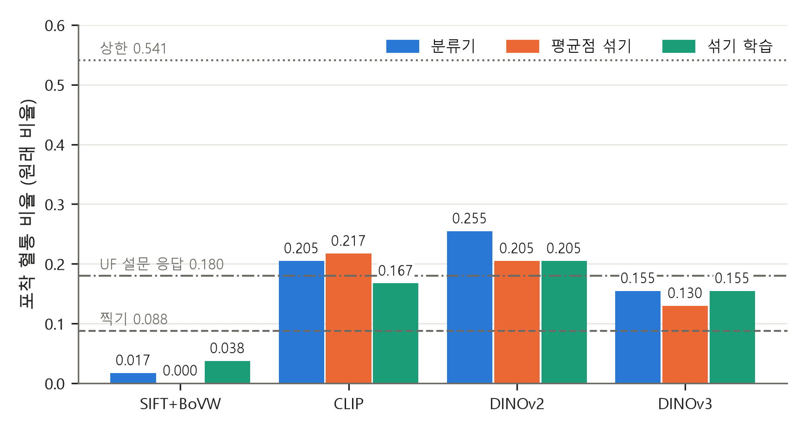
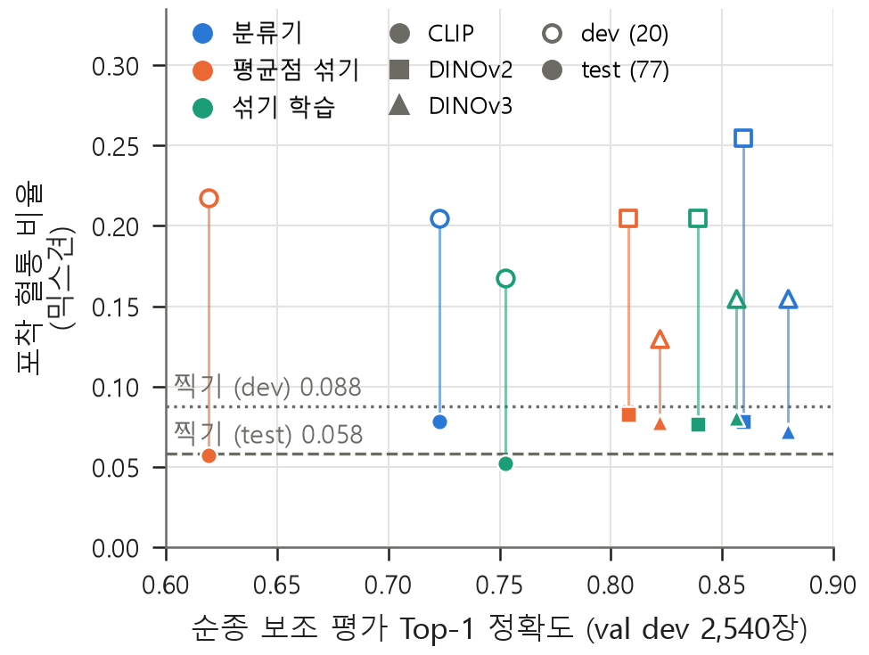
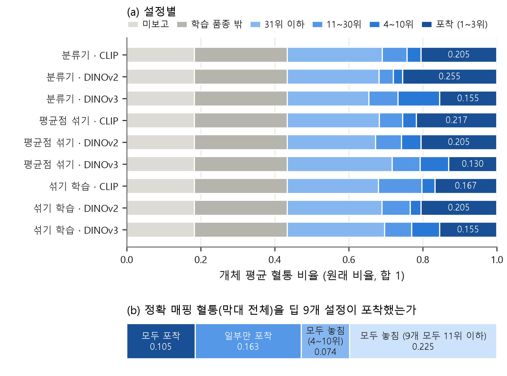
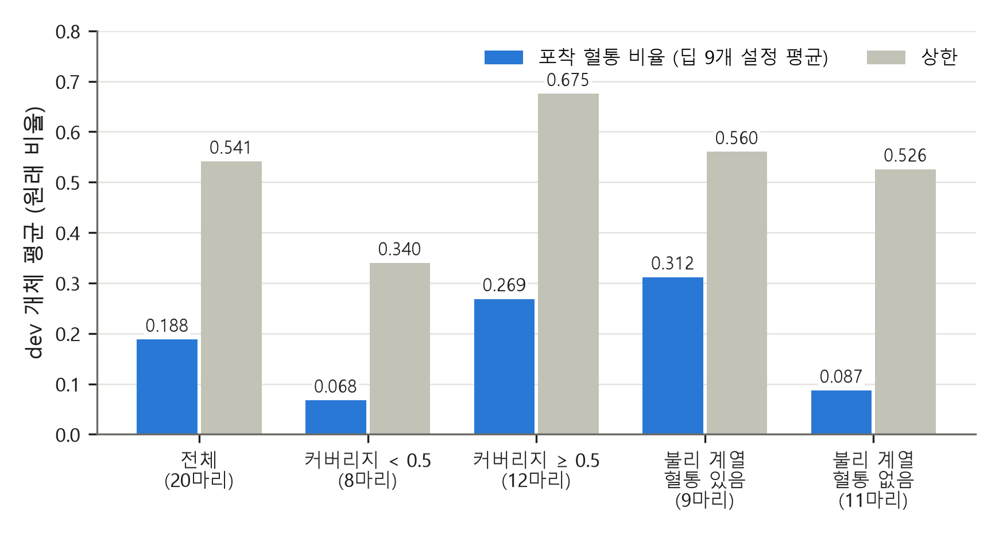

## IV. RESULTS

<!--
작업 메모 (docx에는 나오지 않는다). 값의 출처 (2026-11-24 확인)
- A 값은 A/A/ (A 최종 정리본)만 근거로 쓴다. A/A/README.md · A_METHODOLOGY_FINAL.md 6절에 따라 hold Top-1(바깥 A/results/, 2026-11-23)은 현재 결과에 넣지 않는다 (2026-11-24 반영)
- 표 IV (dev 주 지표): B/results/dev_rq1_comparison.csv. 세 담당의 개체 단위 예측(A RQ1-*-clf-s1..3, B RQ1-*-proto-r1..3 L2 없음, C RQ1-*-mix-s1..3)을 B/scripts/collect_rq1_preds.py로 모으고 B/scripts/compare_rq1_dev.py가 같은 채점 코드로 계산. A · C 값은 각 담당이 직접 낸 값과 같음(A/A/results/dev_ratio_metrics_exact.csv, C/results/results/metrics/RQ1_dev_metrics_final.csv). 사람 응답은 B/results/dev_human_baseline.csv. 정확 매핑만
- 표 IV의 분포 겹침(재정규화)은 dev_rq1_comparison.csv의 overlap_norm, 찍기 대비 판정·반복 범위는 같은 파일의 vs_chance_diff/vs_chance_2se/vs_chance, captured_orig_rep_min/max. A 행은 A/A/results/dev_ratio_metrics_exact.csv(overlap_norm_ensemble 등)와 일치 확인 (2026-11-24). 매핑은 A 최종 breed_map.csv라 "임시, 매핑 초안" 딱지를 뗐다
- 방법 짝 비교 · 같은 가중치 결합: B/results/dev_rq1_paired.csv, dev_rq1_equal_weight.csv
- 분류기 val 전체 5,080장 Top-1(시드 평균): A/A/docs/A_TRAINED_MODELS_SUMMARY.md 4절 (9.53%, 72.45%, 85.63%, 87.94%). 같은 문서 5절의 HOLD Top-1(71마리)은 hold 규칙에 따라 쓰지 않음
- SIFT 공식 특징은 v2로 고정(2026-11-25 사용자 결정. 세 방법이 모두 v2로 실행되어 있고 v3는 C 섞기 학습 dev 1건뿐). v3는 원인 검증으로만 서술
- SIFT v3 (2026-11-25, C/sift_analysis.md 갱신본): 코사인 중앙값 0.662(최소 0.484), 미사용 단어 73 = 표준편차<1e-3 차원 73, |z| 사진별 최댓값 중앙 val 2.6 · UF 약 133,000, v3 dev 포착@3 0.0326(시드 0.0403/0.0701/0.0451), 재정규화 0.0621, 겹침 0.0711, Top-1 2/18, 1위 golden_retriever 8 · Labrador 6, 순종 dev Top-1 0.0756/0.0705/0.0791. 모두 C의 값(B 재계산 안 함). C 문서의 'UF 100마리' 1위 품종 집계는 hold 포함이라 쓰지 않음. 문헌 확인: Göring 2013 표 1(인식률 SIFT whole image 0.2157, color names 0.0617; 본문에 opponent SIFT BoW라고 씀), Tsinghua 공식 페이지 Benchmarking 표(Inception v3 77.7, WS-DAN 86.4). C 문서의 Chatfield 2014 'IFV 56.6 대 DeCAF 79.5'는 원문과 다름(기본 IFV 개 AP 44.8, 56.6은 개선 IFV 행) → 쓰지 않음. CS231A 학생 보고서는 인용하지 않음
- 표 VIII (순종): B/results/purebred_top1_same_set.csv. 세 방법 모두 val dev 절반 2,540장(val_split_seed1.csv). 분류기는 A의 validation_predictions.csv를 dev 행으로 다시 셈, 평균점 섞기는 B/results/model_summary.csv(L2 없음, SIFT는 로컬 실행 RQ1-val-sift-proto-r1..3에서 직접 셈), 섞기 학습과 단일 라벨 대조는 C/docs/experiment_log_RQ1.csv
- 표 V (방법 짝 비교): B/results/dev_rq1_paired.csv (딥 3종 행만). 개체별 상관 per_dog_corr
- 그림 3: B/scripts/report_figures.py fig_purebred_vs_mixed ← purebred_top1_same_set.csv + dev_rq1_comparison.csv
- 표 VI (결합): B/scripts/combo_analysis_dev.py → B/results/dev_combo_analysis.csv. "1마리에서만 더 맞힘"은 B/docs/A_VS_B_INTERPRETATION.md ⑤
- 표 VII (특징 종류): B/scripts/improve_from_shards.py → improve_eval.py --a-impl torch → B/results/improve_dev_full.csv (학습셋 전체, Colab). 가짜 믹스 대리 지표는 proxy_mix_captured3. 품종당 30장 값(B DINOv2 0.255)은 B/results/improve_dev.csv
- SIFT η²: B/results/feature_separability.csv, 키포인트: B/results/sift_keypoints.csv
- SIFT 보충(2026-11-25): C/sift_analysis.md. 코사인 0.66 · 미사용 단어 73개 · |z| 최대 약 13만은 C의 점검값(B가 재계산하지 않음). C 문서의 순종 9.5%는 B 표(같은 2,540장, 분류기 0.091)와 집합이 달라 쓰지 않음. 선행 연구 수치(Stanford Dogs 21.6%, Columbia Dogs 약 5%, Tsinghua 벤치마크 77.7~86.4%)는 원문 확인 실패로 넣지 않음: Khosla 2011 본문에는 기준선 수치가 없고(웹페이지 그래프에만 있음), Liu 2012 · Zou 2020 원문은 접근 실패. Khosla 2011의 난점 서술(작은 품종 간 차이, 큰 품종 내 차이, 바셋하운드·블러드하운드 예)은 원문 PDF 1쪽에서 확인
- 그림 5 · 불리 계열: B/results/dog_difficulty.csv, bully_bias.csv (feature_diagnostics.py, 집계값만). 그림은 report_figures.py fig_dog_groups (파일 fig5_dev_dog_groups.png)
- test(hold) 결과: 2026-11-26 B가 최종 1회 채점. 표 IV-T는 B/results/hold_rq1_comparison.csv, 표 V-T는 hold_rq1_paired.csv, 사람 응답은 hold_human_baseline.csv. 다시 채점하지 않는다
- 그림 4 · 실패 단계: B/scripts/failure_stage_dev.py → B/results/dev_failure_stages.csv (2026-11-25). 반올림은 0.5 올림(0.1625 → 0.163, 0.0125 → 0.013). 0.433 = 1 − 평균 커버리지 0.567(0.182 + 0.251)
- 4.1 순서(2026-11-25): RQ1 두 축(풀이 방식 → 특징 종류) → 순종 → 실패 단계(그림 4) → 개체(그림 5) → 설정 고정. 추출기 일관성은 B/results/dev_rq1_paired.csv의 부호
- 표 IX (RQ2 test): B/scripts/final_rq2.py --split hold → outputs/final_rq2/hold/ (scores_hold.csv, extra_drop_hold.csv, per_dog_hold.csv, 로컬 전용). SAM 3 마스크, 딥은 A 분류기, SIFT는 v3 + C 섞기 학습. D의 dev 예비 결과(GrabCut)는 최종 결과로 대체
-->

test 77마리는 dev에서 고정한 설정으로 한 번만 채점했다. 결론은 test 결과로 내리고, dev 20마리의 결과는 설정을 어떻게 정했는지를 설명하는 데만 쓴다. RQ1은 세 방법과 네 추출기 전부를 dev와 test에서 채점했고, 보조 점검(결합 모델, 특징 종류, 실패 단계, 개체 단위 분석)은 dev에서만 했다. RQ2는 test에서 네 추출기 모두에 대해 실행했다.

### A. Proportion Recovery (RQ1)

이 절은 RQ1에 답한다. 세 가지 풀이 방식과 네 가지 특징 추출기에서 구성 비율이 얼마나 복원되는지를 보고한다. 먼저 결론의 근거인 test 77마리의 1회 채점 결과(표 IV-T, V-T)를 보고한다. 이어서 설정을 정한 dev 20마리의 결과를 RQ1의 두 축(풀이 방식, 특징 추출기와 특징 종류)을 따라 보고하고, 순종 보조 평가(val dev 절반 2,540장)와 대조한 뒤, 차이가 작게 나타난 이유를 실패 단계와 개체 단위에서 살핀다. dev 값은 표본이 작아 방법이나 추출기 사이의 차이를 판단하는 근거로 쓰지 않는다.

**test 결과.** 표 IV-T는 dev에서 고정한 설정으로 test 77마리를 한 번 채점한 결과다(평균 커버리지 0.569). 찍기는 0.058, 상한은 0.548이었다. 딥 특징 9개 설정은 0.052~0.083이었고, 개체 단위로 찍기와 비교해 구별되는 설정은 없었다. 차이가 가장 큰 것은 평균점 섞기의 DINOv2(+0.024 ± 0.046)와 섞기 학습의 DINOv3(+0.022 ± 0.040)였다. SIFT+BoVW는 분류기(−0.044 ± 0.032)와 평균점 섞기(−0.045 ± 0.034)가 찍기보다 낮았으나 해석하지 않는다. Top-1 일치는 채점 가능한 66마리 가운데 4~8마리였고, 딥 설정 가운데 하나라도 Top-1을 맞힌 개체는 15마리였다. UF 전문가들이 가장 많이 고른 품종 3개는 0.144로 찍기보다 높았다(+0.086 ± 0.052). 반복에 따른 딥 설정의 점수 범위는 최대 0.030이었다(섞기 학습 DINOv2, 0.071~0.101).

**표 IV-T. test에서 포착 혈통 비율, 분포 겹침, Top-1 일치** (test 77마리, 평균 커버리지 0.569, Top-1은 채점 가능 66마리(UF 설문은 69마리). 고정한 설정으로 1회 채점, 정확 매핑만)

| 방법 | 추출기 | 포착 혈통 비율 (원래 비율) | 포착 혈통 비율 (재정규화) | 분포 겹침 (재정규화) | Top-1 일치 [Wilson 95%] |
|---|---|---|---|---|---|
| 찍기 | — | 0.058 | 0.097 | 0.034 | — |
| 분류기 | SIFT+BoVW† | 0.015 | 0.022 | 0.025 | 1/66 (0.015) [0.003, 0.081] |
| 분류기 | CLIP | 0.078 | 0.144 | 0.047 | 8/66 (0.121) [0.063, 0.221] |
| 분류기 | DINOv2 | 0.078 | 0.139 | 0.068 | 4/66 (0.061) [0.024, 0.146] |
| 분류기 | DINOv3 | 0.072 | 0.128 | 0.071 | 5/66 (0.076) [0.033, 0.165] |
| 평균점 섞기 | SIFT+BoVW† | 0.013 | 0.018 | 0.005 | 0/66 (0.000) [0.000, 0.055] |
| 평균점 섞기 | CLIP | 0.057 | 0.100 | 0.051 | 4/66 (0.061) [0.024, 0.146] |
| 평균점 섞기 | DINOv2 | 0.083 | 0.144 | 0.076 | 4/66 (0.061) [0.024, 0.146] |
| 평균점 섞기 | DINOv3 | 0.078 | 0.130 | 0.073 | 4/66 (0.061) [0.024, 0.146] |
| 섞기 학습 | SIFT+BoVW† | 0.023 | 0.037 | 0.033 | 1/66 (0.015) [0.003, 0.081] |
| 섞기 학습 | CLIP | 0.052 | 0.092 | 0.064 | 7/66 (0.106) [0.052, 0.203] |
| 섞기 학습 | DINOv2 | 0.076 | 0.139 | 0.068 | 5/66 (0.076) [0.033, 0.165] |
| 섞기 학습 | DINOv3 | 0.080 | 0.133 | 0.088 | 7/66 (0.106) [0.052, 0.203] |
| UF 설문 응답 (참고) | — | 0.144 | 0.240 | — | 21/69 (0.304) [0.208, 0.421] |
| 상한 | — | 0.548 | 0.974 | 1.000 | — |

채점 방식은 표 IV와 같다. †SIFT+BoVW 행은 수정 전 특징의 값이며 해석하지 않는다(아래 "SIFT+BoVW 결과").

**test에서 풀이 방식에 따른 차이.** 표 V-T의 9개 비교 가운데 7개는 판단 불가였다. 나머지 둘은 모두 CLIP에서 나왔고, 분류기가 평균점 섞기(+0.021 ± 0.016)와 섞기 학습(+0.026 ± 0.022)보다 높았다. 세 짝 모두 차이의 부호가 추출기에 따라 달라, III-D절의 규칙으로 모든 비교가 추출기 의존이다. 개체별 점수는 이번에도 방법 사이에 상관이 높았다(0.62~0.89). 따라서 혼합 모형을 명시적으로 넣은 평균점 섞기나 섞기 학습이 분류기 확률을 그대로 읽는 것보다 구성 비율을 더 잘 복원한다는 근거는 없다.

**표 V-T. test에서 방법 짝별 포착 혈통 비율의 차이** (test 77마리, 원래 비율, 딥 특징 3종. 앞 방법 − 뒤 방법의 개체 단위 짝 차이 평균 ± 2SE, 보정 전)

| 추출기 | 방법 짝 | 차이 | 판정 | 개체별 점수 상관 |
|---|---|---|---|---|
| CLIP | 분류기 − 평균점 섞기 | +0.021 ± 0.016 | 분류기가 높음 (보정 전) | 0.891 |
| CLIP | 분류기 − 섞기 학습 | +0.026 ± 0.022 | 분류기가 높음 (보정 전) | 0.784 |
| CLIP | 평균점 섞기 − 섞기 학습 | +0.005 ± 0.019 | 판단 불가 | 0.811 |
| DINOv2 | 분류기 − 평균점 섞기 | −0.005 ± 0.022 | 판단 불가 | 0.849 |
| DINOv2 | 분류기 − 섞기 학습 | +0.002 ± 0.029 | 판단 불가 | 0.678 |
| DINOv2 | 평균점 섞기 − 섞기 학습 | +0.006 ± 0.029 | 판단 불가 | 0.687 |
| DINOv3 | 분류기 − 평균점 섞기 | −0.005 ± 0.021 | 판단 불가 | 0.844 |
| DINOv3 | 분류기 − 섞기 학습 | −0.008 ± 0.031 | 판단 불가 | 0.620 |
| DINOv3 | 평균점 섞기 − 섞기 학습 | −0.003 ± 0.030 | 판단 불가 | 0.685 |

**dev 점수가 이어지지 않은 이유.** 딥 설정마다 dev 점수(0.130~0.255, 표 IV)는 test 점수의 1.7~3.8배였다. dev에서는 점수의 상당 부분이 불리 계열 혈통이 있는 개체에서 나왔는데(아래 "개체 단위 분석"), 이런 개체는 dev 20마리 중 9마리였지만 test 77마리 중에는 15마리뿐이었다. 커버리지는 비슷했으므로(0.567 대 0.569), 우리는 이 차이를 학습 품종이 혈통을 얼마나 덮는지가 아니라 개체가 어떤 품종을 지녔는지의 차이로 읽는다(증명 아님). 아래 dev 결과는 설정을 어떻게 정했는지를 설명하며, 그 수치는 이 용도로만 읽는다.

**dev 결과(설정 선택).** 이하 표 IV~VIII과 그림 2~5는 dev 20마리와 순종 val dev 절반의 결과다.

**dev 주 지표.** 표 IV는 dev 20마리에서 계산한 주 지표다. 찍기는 원래 비율 기준 0.088, 상한은 0.541이다. 세 방법의 값은 딥 특징 세 추출기에서 0.130~0.255였다. SIFT+BoVW의 믹스견 결과는 해석하지 않는다. 평가 사진의 SIFT 특징이 학습 특징과 다른 시각 어휘(코드북)로 만들어졌기 때문이다(아래 "SIFT+BoVW 결과"). 같은 개체에 대해 UF 설문 참가자들이 가장 많이 고른 품종 3개로 같은 지표를 계산하면 0.180이다. 그림 2는 같은 값을 추출기별로 나타낸 것이다. test의 같은 지표는 표 IV-T에 있다.

**표 IV. dev에서 포착 혈통 비율, 분포 겹침, Top-1 일치** (dev 20마리, 평균 커버리지 0.567, Top-1은 채점 가능 18마리(Top-1 평가 가능 비율 18/20). 설정 선택용 dev 값이며, A 최종 정의(정확 매핑만)로 채점)

| 방법 | 추출기 | 포착 혈통 비율 (원래 비율) | 포착 혈통 비율 (재정규화) | 분포 겹침 (재정규화) | Top-1 일치 [Wilson 95%] |
|---|---|---|---|---|---|
| 찍기 | — | 0.088 | 0.168 | 0.047 | — |
| 분류기 | SIFT+BoVW† | 0.017 | 0.043 | 0.023 | 0/18 (0.000) [0.000, 0.176] |
| 분류기 | CLIP | 0.205 | 0.358 | 0.095 | 5/18 (0.278) [0.125, 0.509] |
| 분류기 | DINOv2 | 0.255 | 0.441 | 0.198 | 5/18 (0.278) [0.125, 0.509] |
| 분류기 | DINOv3 | 0.155 | 0.258 | 0.142 | 4/18 (0.222) [0.090, 0.452] |
| 평균점 섞기 | SIFT+BoVW† | 0.000 | 0.000 | 0.000 | 0/18 (0.000) [0.000, 0.176] |
| 평균점 섞기 | CLIP | 0.217 | 0.378 | 0.167 | 5/18 (0.278) [0.125, 0.509] |
| 평균점 섞기 | DINOv2 | 0.205 | 0.334 | 0.183 | 5/18 (0.278) [0.125, 0.509] |
| 평균점 섞기 | DINOv3 | 0.130 | 0.222 | 0.136 | 3/18 (0.167) [0.058, 0.392] |
| 섞기 학습 | SIFT+BoVW† | 0.038 | 0.063 | 0.017 | 0/18 (0.000) [0.000, 0.176] |
| 섞기 학습 | CLIP | 0.167 | 0.275 | 0.164 | 4/18 (0.222) [0.090, 0.452] |
| 섞기 학습 | DINOv2 | 0.205 | 0.372 | 0.178 | 4/18 (0.222) [0.090, 0.452] |
| 섞기 학습 | DINOv3 | 0.155 | 0.241 | 0.132 | 3/18 (0.167) [0.058, 0.392] |
| UF 설문 응답 (참고) | — | 0.180 | 0.313 | — | 6/18 (0.333) [0.163, 0.563] |
| 상한 | — | 0.541 | 0.970 | 1.000 | — |

분류기와 섞기 학습은 시드 3개의 예측 확률을, 평균점 섞기는 부분 표본 3회의 예측 비율을 평균해 채점한 값이다. 세 방법 모두 같은 채점 코드로 계산했다. 평균점 섞기는 L2 정규화 없이 계산했다. 평균점 섞기에서 L2 정규화를 켜도 모든 지표의 차이는 0.003 이하였다. UF 설문 응답은 사람이 고른 품종 순서만 있고 비율이 없어서 포착 혈통 비율과 Top-1 일치만 계산했다. †SIFT+BoVW 행은 수정 전 특징의 값이며, 평가 특징의 시각 어휘 불일치로 해석하지 않는다(아래 "SIFT+BoVW 결과").

원래 비율의 포착 혈통 비율을 개체 단위로 찍기와 비교하면(짝 차이의 평균 ± 2SE), 12개 설정 가운데 찍기보다 높다고 판단된 것은 분류기의 DINOv2(+0.167 ± 0.122)와 평균점 섞기의 CLIP(+0.129 ± 0.125), DINOv2(+0.117 ± 0.112) 세 개였다. SIFT+BoVW의 분류기(−0.071 ± 0.049)와 평균점 섞기(−0.088 ± 0.051)는 찍기보다 낮았으나 아래 이유로 해석하지 않는다. 나머지 일곱 개는 구간이 0을 포함해 판단 불가였다. 섞기 학습은 네 추출기 모두 판단 불가였다. UF 설문 응답도 찍기와의 차이가 +0.092 ± 0.111로 판단 불가였다. 반복에 따른 점수의 범위(반복별 점수의 최소~최대 폭)는 딥 특징에서 분류기 0.005~0.038, 평균점 섞기 0.013~0.038, 섞기 학습 0.032~0.050이었다. 대표값은 세 반복의 예측을 평균한 뒤 채점하므로 반복별 점수의 범위 밖에 놓일 수 있다. 예를 들어 평균점 섞기의 CLIP은 대표값이 0.217이고 반복 범위는 0.167–0.205다. 이 비교는 설정 선택용 dev 20마리의 값이며, 다중 비교를 보정하지 않았고 결론으로 쓰지 않는다.

**그림 2. dev에서 포착 혈통 비율 (원래 비율).** dev 20마리, 정확 매핑. 막대는 분류기, 평균점 섞기, 섞기 학습이다. 점선은 찍기, 일점쇄선은 UF 설문 응답, 점선(위)은 상한이다. 설정 선택용 dev 값이며, A 최종 정의(정확 매핑만)로 채점했다. SIFT+BoVW 막대는 평가 특징의 코드북 불일치로 해석하지 않는다.

**풀이 방식에 따른 차이.** 표 V는 딥 특징 세 가지에서 방법 두 개씩을 개체 단위로 비교한 결과다. 9개 비교 가운데 8개는 구간이 0을 포함해 판단 불가였다. 나머지 하나는 DINOv2에서 분류기와 평균점 섞기의 차이(+0.050 ± 0.046)로, 구간의 아래 끝이 0에 가깝고 다중 비교를 보정하기 전 값이다. 섞기 학습은 세 추출기 모두에서 분류기와 같거나 낮았고(차이 0.000~0.050), 모두 판단 불가였다. 비율을 직접 맞히도록 학습한 방법이 dev 믹스견에서 이득을 보인다는 근거는 없었다.

**표 V. 방법 짝별 포착 혈통 비율의 차이** (dev 20마리, 원래 비율, 딥 특징 3종. 차이는 앞 방법 − 뒤 방법의 개체 단위 짝 차이 평균 ± 2SE)

| 추출기 | 방법 짝 | 차이 | 판정 | 개체별 점수 상관 |
|---|---|---|---|---|
| CLIP | 분류기 − 평균점 섞기 | −0.013 ± 0.025 | 판단 불가 | 0.967 |
| CLIP | 분류기 − 섞기 학습 | +0.038 ± 0.055 | 판단 불가 | 0.843 |
| CLIP | 평균점 섞기 − 섞기 학습 | +0.050 ± 0.059 | 판단 불가 | 0.816 |
| DINOv2 | 분류기 − 평균점 섞기 | +0.050 ± 0.046 | 분류기가 높음 (보정 전) | 0.878 |
| DINOv2 | 분류기 − 섞기 학습 | +0.050 ± 0.059 | 판단 불가 | 0.801 |
| DINOv2 | 평균점 섞기 − 섞기 학습 | 0.000 ± 0.073 | 판단 불가 | 0.686 |
| DINOv3 | 분류기 − 평균점 섞기 | +0.025 ± 0.034 | 판단 불가 | 0.925 |
| DINOv3 | 분류기 − 섞기 학습 | 0.000 ± 0.073 | 판단 불가 | 0.680 |
| DINOv3 | 평균점 섞기 − 섞기 학습 | −0.025 ± 0.080 | 판단 불가 | 0.580 |

세 방법의 개체별 점수는 서로 상관이 높았다(0.58~0.97). 분류기와 평균점 섞기의 상관(0.88~0.97)이 가장 높고, 섞기 학습이 끼는 짝은 그보다 낮았다. 딥 특징 3종과 세 방법의 9개 설정 가운데 하나라도 Top-1을 맞힌 개체는 채점 가능한 18마리 중 9마리였고, 9개 설정이 모두 포착 혈통 비율 0을 낸 개체는 6마리였다. 우리는 이를 방법이 달라도 같은 개체에서 맞히고 같은 개체에서 틀리는 경향으로 읽는다(dev 20마리의 관찰이며 결론이 아니다). test의 방법 짝 비교는 표 V-T에 있다. dev에서 유일하게 0을 벗어났던 DINOv2의 분류기 − 평균점 섞기(+0.050 ± 0.046)는 test에서 이어지지 않았다(−0.005 ± 0.022).

**결합 모델.** 표 VI은 딥 9개 설정의 예측을 같은 가중치로 결합한 결과다(III-C절). 결합이 도움이 되지 않은 이유는 아래 "실패 단계"에서 본다. 산술 평균만 단일 최고 설정(분류기, DINOv2, 0.255)보다 높았고(0.267), 그 차이(+0.013 ± 0.025)는 판단 불가였다. 산술 평균은 20마리 중 1마리에서만 더 맞혔다. 기하 평균과 순위 합산은 단일 최고 설정보다 낮았다. 개체마다 9개 설정 가운데 가장 좋은 것을 고르는 오라클도 0.255로, 단일 최고 설정과 같았다. 다른 설정이 맞히는 개체는 단일 최고 설정이 맞히는 개체에 포함되어, 결합해도 새로 맞힐 개체가 거의 없다는 뜻이다. 한 마리씩 빼고 나머지 19마리로 후보(단일 9개, 결합 28개) 가운데 최고를 고른 뒤 뺀 개체에 적용하면 0.255였다. 개체를 복원 추출한 2,000회에서 9개 산술 평균이 같은 표본의 단일 최고를 이긴 비율은 0.648이었다. dev에서는 결합이 이득을 준다는 근거가 없으므로, 결합 모델은 쓰지 않는다.

**표 VI. 결합 방식별 포착 혈통 비율** (dev 20마리, 원래 비율, 딥 특징 3종 × 세 방법 = 9개 설정. 차이는 결합 − 단일 최고 설정의 개체 단위 짝 차이 ± 2SE)

| 결합 방식 | 포착 혈통 비율 | Top-1 일치 | 단일 최고 설정과의 차이 |
|---|---|---|---|
| 단일 최고 설정 (분류기, DINOv2) | 0.255 | 5/18 | — |
| 산술 평균 | 0.267 | 6/18 | +0.013 ± 0.025 (판단 불가) |
| 기하 평균 | 0.167 | 5/18 | −0.087 ± 0.066 (낮음) |
| 순위 합산 | 0.135 | 5/18 | −0.120 ± 0.076 (낮음) |
| 상위 3개 투표 | 0.217 | 5/18 | −0.037 ± 0.041 (판단 불가) |
| 오라클 (개체마다 9개 중 최고) | 0.255 | — | — |
| 19마리로 고르고 남은 1마리에 적용 | 0.255 | — | 0.000 |

**특징 추출기에 따른 차이.** RQ1의 다른 축은 같은 비교가 특징 추출기에 따라 달라지는가이다. III-D절의 규칙대로 표 V의 방법 짝 차이의 부호를 딥 특징 세 가지에서 비교했다. 분류기 − 평균점 섞기는 CLIP에서 음수(−0.013), DINOv2와 DINOv3에서 양수(+0.050, +0.025)였다. 평균점 섞기 − 섞기 학습은 CLIP에서 양수(+0.050), DINOv2에서 0.000, DINOv3에서 음수(−0.025)였다. 이 두 짝은 추출기에 따라 부호가 달라 추출기 의존이다. 분류기 − 섞기 학습은 CLIP과 DINOv2에서 양수(+0.038, +0.050)이고 DINOv3에서 0.000 ± 0.073이었다. 다만 이 차이들은 모두 판단 불가 범위에 있으므로(표 V), 부호가 다른 것도 표본의 우연일 수 있다. 같은 방법 안에서 딥 특징 세 가지의 포착 혈통 비율은 0.130~0.255 범위였고, 추출기 사이의 개체 단위 비교는 하지 않았다. test에서는 세 짝 모두 추출기에 따라 부호가 달라 모두 추출기 의존이었다(표 V-T).

**특징 종류.** 표 VII은 전역 특징(CLS 토큰, CLIP은 투영 이미지 임베딩) 대신 패치 토큰 평균이나 둘을 이어 붙인 특징을 쓴 결과다(III-C절). 이 실험은 세 방법을 학습셋 전체로 다시 학습했으므로, CLS 열은 표 IV와 다를 수 있다. 평균점 섞기는 세 추출기 모두 표 IV와 같았고, 분류기는 CLIP만 0.217(표 IV는 0.205)이었다. 섞기 학습은 재학습만으로 DINOv2가 0.192(표 IV는 0.205), DINOv3가 0.205(표 IV는 0.155)로 바뀌었다. 패치 평균과 이어 붙이기의 18개 조합 가운데 CLS보다 높다고 판단된 조합은 없었다. 패치 평균은 DINOv2의 분류기(−0.105 ± 0.066)와 평균점 섞기(−0.142 ± 0.084), DINOv3의 섞기 학습(−0.087 ± 0.075)에서 CLS보다 낮았다. 이어 붙인 특징은 CLS와의 차이가 −0.087~+0.013이었고, 높아진 조합은 모두 판단 불가였다.

**표 VII. 특징 종류별 포착 혈통 비율** (dev 20마리, 원래 비율, 학습셋 전체로 재학습. ▼는 CLS보다 낮다고 판단된 조합, 개체 단위 짝 차이 ± 2SE)

| 추출기 | 방법 | CLS | 패치 평균 | 이어 붙이기 |
|---|---|---|---|---|
| CLIP | 분류기 | 0.217 | 0.180 | 0.167 |
| CLIP | 평균점 섞기 | 0.217 | 0.167 | 0.205 |
| CLIP | 섞기 학습 | 0.167 | 0.130 | 0.180 |
| DINOv2 | 분류기 | 0.255 | 0.150 ▼ | 0.225 |
| DINOv2 | 평균점 섞기 | 0.205 | 0.063 ▼ | 0.188 |
| DINOv2 | 섞기 학습 | 0.192 | 0.125 | 0.180 |
| DINOv3 | 분류기 | 0.155 | 0.167 | 0.155 |
| DINOv3 | 평균점 섞기 | 0.130 | 0.142 | 0.142 |
| DINOv3 | 섞기 학습 | 0.205 | 0.117 ▼ | 0.117 ▼ |

믹스견을 쓰지 않는 대리 지표로 설정을 고르는 방법도 점검했다. 대리 지표는 순종 Top-1과, 검증 사진 특징을 섞어 만든 특징 공간의 가짜 믹스에서 잰 포착 혈통 비율이다. 가짜 믹스에서는 평균점 섞기와 섞기 학습이 분류기만큼 또는 그보다 높았지만(DINOv2 CLS에서 0.792, 0.777 대 0.753), 실제 믹스견에서는 그 우위가 나타나지 않았다. 대리 지표로 고른 설정의 dev 점수는 CLIP 0.180, DINOv2 0.205, DINOv3 0.130으로, 세 추출기 모두 dev에서 가장 높은 설정이 아니었다. 우리는 이를 평균점 섞기와 섞기 학습이 함께 기대는 "품종 특징의 선형 결합이 믹스견의 특징"이라는 가정이 실제 믹스견 사진에서는 잘 맞지 않는다는 근거로 읽는다(증명 아님).

dev 점수는 설정 밖의 조건에도 흔들렸다. 평균점 섞기의 DINOv2는 품종당 학습 사진 30장으로 평균점을 만들면 0.255, 학습셋 전체로 만들면 0.205였다. 섞기 학습의 DINOv3는 같은 설정의 재학습만으로 0.155에서 0.205로 바뀌었다. 20마리에서 0.05는 한 마리의 점수 1.0에 해당하므로, 이 크기의 차이로 설정을 고르면 표본의 우연을 고르게 된다.

**SIFT+BoVW 결과.** SIFT+BoVW는 순종 사진에서도 품종 신호가 약했다. 세 추출기에 공통인 학습 사진 800장(8품종 × 100장)에서 품종이 설명하는 분산의 비율($\eta^2$)은 SIFT+BoVW 0.027, CLIP 0.245, DINOv2 0.408이었고, 127클래스 학습셋 전체에서도 SIFT+BoVW는 0.039였다. 원인은 표현의 구성에 있다. 시각 단어 히스토그램은 지역 기울기 패턴이 나온 횟수만 세고 귀, 주둥이, 몸 비율 같은 배치 정보를 남기지 않는다. 우리 설정은 흑백 영상에서 계산하므로 털색도 쓰지 못하고, 시각 단어 512개는 127개 품종을 나누기에 적다. 개 품종 분류는 품종 사이의 차이가 작고 품종 안의 차이가 큰 과제다. 예를 들어 바셋하운드와 블러드하운드는 얼굴 생김새가 비슷하고 털색이 다르다(Khosla et al., 2011). 색과 배치를 함께 버리는 표현에는 특히 불리한 조건이다.

이 낮은 값은 선행 연구의 범위와 맞는다. 같은 120품종 개 분류 과제(ILSVRC 2012 세밀 분류)에서 색을 담은 opponent SIFT의 단어 가방 표현은 검증 세트 인식률 0.216, 색 이름 특징만으로는 0.062였다(Göring et al., 2013). 흑백 SIFT+BoVW인 우리 설정의 순종 Top-1(표 VIII 분류기 0.091, val 전체 0.095)은 색을 뺀 표현이 그보다 낮은 범위에 놓인다는 점과 맞는다. 같은 학습 사진과 검증 사진에서 딥 특징 세 가지는 0.723~0.879였고, 이는 Tsinghua Dogs 공식 벤치마크의 범위(Inception v3 0.777에서 WS-DAN 0.864; Zou et al., 2020)와 비슷하다. 두 비교 모두 클래스 수, 평가 사진, 전처리가 달라 직접 비교는 아니다. 다만 같은 데이터 처리 과정에서 딥 특징이 기대 범위에 들어가므로, SIFT+BoVW의 낮은 순종 성능은 데이터 처리의 문제가 아니라 표현의 차이로 읽는다.

믹스견 평가 사진의 SIFT+BoVW 특징에는 이와 별개로 구현 오류가 있었다. 학습 특징을 만들 때 저장된 시각 어휘를 그대로 쓰지 않고 난수를 고정하지 않은 채 한 번 더 군집화해, 같은 단어 번호가 학습 특징과 평가 특징에서 서로 다른 모양을 가리켰다. 담당 C의 점검에서 저장된 어휘로 학습 사진의 특징을 다시 계산하면 원래 특징과의 코사인 유사도는 중앙값 0.662(최소 0.484)였다. 512개 단어 가운데 73개는 학습 특징에서 한 번도 쓰이지 않아 학습 통계의 표준편차가 0에 가까웠다. 그런데 믹스견 특징에는 이 차원에 값이 들어가, 학습 통계로 표준화한 값의 사진별 최댓값이 중앙값 약 13만에 이르렀다(검증 사진은 2.6). 이렇게 몇몇 차원이 예측을 지배해, 예측이 특정 품종으로 쏠렸다. 우리는 단어별 사용 비율로도 불일치를 확인했다. 학습 사진과 검증 사진 40장의 단어 사용 비율 순위 상관은 0.904였지만, 학습 사진과 믹스견 dev 사진 40장은 0.234였다. 믹스견 사진의 키포인트는 학습 사진보다 적었지만(중앙값 144개 대 390개), 검증 사진 가운데 믹스견 사진처럼 쓰인 단어가 적은 사진(80~130개)만 골라도 순위 상관은 0.936이었으므로, 이 차이는 키포인트 수로 설명되지 않는다.

담당 C는 저장된 어휘에 바로 배정하는 방식으로 학습 특징을 다시 추출하고(쓰이지 않은 단어 73개 → 0개), 섞기 학습을 같은 설정의 시드 3개로 다시 학습해 dev를 다시 채점했다. 수정 후 1위 예측은 철사털, 장식털 품종으로 쏠리던 모양에서 리트리버 계열로 바뀌었고(20마리 중 14마리), 분포 겹침은 0.017에서 0.071로 올라 찍기(0.047)를 넘었다. Top-1 일치도 0/18에서 2/18이 되었다. 그러나 포착 혈통 비율은 0.038에서 0.033(시드별 0.040, 0.070, 0.045)으로, 여전히 찍기(0.088)보다 수치상 낮았다. 순종 Top-1은 0.071~0.079로 수정 전과 같은 수준이었다. 학습과 검증이 같은 어휘를 쓰던 순종 쪽은 오류의 영향을 받지 않았기 때문이다. 우리는 이를 SIFT+BoVW의 믹스견 결과에 구현 오류와 표현의 한계가 겹쳐 있었고, 오류를 고친 뒤에도 표현의 한계가 남는다는 뜻으로 읽는다. 수정한 모델은 대부분의 개체에 같은 품종을 1위로 주므로, 비율의 크기는 어느 정도 맞아도 개체마다 다른 품종을 골라내지 못한다. 표 IV와 그림 2의 SIFT+BoVW 믹스견 값은 수정 전 특징의 값이며 해석하지 않는다. 수정한 특징은 섞기 학습 한 가지에서 원인을 확인하는 데에만 썼다. 세 방법을 같은 특징 위에서 비교하기 위해 SIFT+BoVW의 공식 결과는 dev와 test 모두 수정 전 특징으로 채점하고, 믹스견 결과는 해석하지 않는다.

**순종 보조 평가.** 표 VIII은 단일 품종 사진에 대한 Top-1 정확도다. 딥 특징 3종에서 분류기, 평균점 섞기, 섞기 학습 모두 0.6 이상이었고, SIFT+BoVW는 0.1 미만이었다. 네 방법 모두 같은 사진(val의 dev 절반 2,540장)에서 계산했다. 분류기를 val 전체 5,080장에서 재면 SIFT+BoVW 0.095, CLIP 0.725, DINOv2 0.856, DINOv3 0.879로, 표 VIII의 분류기 행과 사진 집합만 다르다. 평균점 섞기는 세 딥 특징에서 분류기보다 0.052~0.104 낮았다. 섞기 학습은 DINOv2와 DINOv3에서 분류기보다 0.021~0.023 낮았고, CLIP에서는 0.030 높았다. 섞기 학습은 같은 설정에서 단일 라벨로만 학습한 대조 모델보다 세 딥 특징에서 0.003~0.018 낮았다. 학습 단계 수는 섞기 학습이 3,200, 대조 모델이 2,420이므로 이 차이는 학습량이 모자라서 생긴 것이 아니다. 따라서 섞기 학습이 순종 분류에서 치르는 비용은 작다. *다만 섞기 학습과 단일 라벨 대조의 학습률은 이 사진들을 포함한 순종 val 전체의 Top-1로 골랐으므로(III-C절), 두 행의 값은 조금 낙관적일 수 있다.*

단일 라벨 대조 모델과 분류기는 둘 다 단일 품종 라벨로 학습하고, 입력 정규화와 최적화 설정만 다르다(III-C절). 그런데도 CLIP에서 두 모델의 차이는 0.048이었다. 따라서 CLIP에서는 입력 처리의 차이가 풀이 방식의 차이와 비슷한 크기로 결과에 영향을 준다.

**표 VIII. 순종 보조 평가의 Top-1 정확도** (val dev 절반 2,540장, 반복 3회 평균)

| 방법 | SIFT+BoVW | CLIP | DINOv2 | DINOv3 |
|---|---|---|---|---|
| 분류기 | 0.091 | 0.723 | 0.860 | 0.879 |
| 평균점 섞기 | 0.071 | 0.619 | 0.808 | 0.822 |
| 섞기 학습 | 0.077 | 0.753 | 0.839 | 0.856 |
| 단일 라벨 대조 (섞기 학습 설정) | 0.074 | 0.771 | 0.842 | 0.870 |

그림 3은 같은 9개 딥 설정의 순종 Top-1과 믹스견 포착 혈통 비율을 함께 놓은 것이다. 순종에서의 순서는 믹스견으로 이어지지 않았다. 세 방법 모두에서 순종 Top-1이 가장 높았던 DINOv3 설정은 믹스견 포착 혈통 비율이 딥 특징 가운데 가장 낮거나 같았다. 반대로 순종 Top-1이 가장 낮은 평균점 섞기의 CLIP(0.619)은 믹스견에서 0.217이었다. test에서는 순종 Top-1이 0.62~0.88인 딥 설정이 모두 찍기 수준에 머물렀다. 우리는 이를 순종 분류 성능이 믹스견 비율 복원을 보장하지 않는다는 관찰로만 읽는다.

**그림 3. 순종 Top-1 정확도와 믹스견 포착 혈통 비율.** 가로축은 순종 보조 평가(val dev 2,540장)의 Top-1, 세로축은 믹스견의 포착 혈통 비율(원래 비율)이다. 속 빈 점은 dev 20마리, 찬 점은 test 77마리이고 같은 설정을 세로선으로 이었다. 색은 풀이 방식, 모양은 특징 추출기, 가로선은 dev와 test의 찍기다. SIFT+BoVW는 믹스견 평가 특징의 코드북 불일치로 뺐다.

**실패 단계.** 두 축의 차이가 작게 나타난 이유와 결합이 도움이 되지 않은 이유를 보기 위해, 예측이 실패하는 단계를 나눴다. 결합이 도움이 되려면 설정마다 실패하는 곳이 달라야 한다. 그래서 개체의 DNA 혈통(원래 비율, 합 1)이 어느 단계에서 사라지는지를 설정마다 나눴다(그림 4a). 정확 매핑된 품종은 예측 비율을 DNA 품종 공간으로 합친 뒤의 순위로 1~3위(포착), 4~10위, 11~30위, 31위 이하로 나눴다. 사진을 보기 전에 이미 0.433을 잃는다. DNA 검사가 비율을 보고하지 않은 몫이 0.182, 학습 품종 밖의 혈통이 0.251이다. 사진으로 맞힐 수 있는 나머지 0.567 가운데 모든 설정에서 가장 큰 몫은 31위 이하로 밀려난 혈통(0.220~0.283)이었다. 4~10위에서 아깝게 놓친 몫은 0.025~0.113으로 작았다. 따라서 상위 3개라는 기준의 경계에서 놓치는 경우보다, 정답 품종이 예측에서 멀리 밀려나는 경우가 대부분이다.

9개 설정을 함께 보면 결합으로 얻을 수 있는 몫이 드러난다(그림 4b). 정확 매핑된 혈통 0.567 가운데 9개 설정이 모두 포착한 몫은 0.105, 일부 설정만 포착한 몫은 0.163이었다. 어느 설정도 포착하지 못한 몫은 0.299였고, 그중 0.225는 9개 설정 모두에서 11위 이하였다. 어느 설정이든 한 번이라도 포착한 몫은 0.267이 최대인데, 단일 최고 설정(분류기, DINOv2)이 이미 0.255를 포착한다. 결합으로 더 얻을 수 있는 몫은 0.013뿐이고, 이는 표 VI의 산술 평균 결합의 이득(+0.013)과 같다. 같은 추출기의 세 방법이 모두 놓친 몫도 CLIP 0.349, DINOv2 0.299, DINOv3 0.387로 컸다. 우리는 이를 실패가 풀이 단계보다 앞선 특징 단계에서 대부분 정해진다는 뜻으로 읽는다.

풀이 방식을 빼고 특징만으로도 같은 점검을 했다. DINOv2 특징에서 학습셋의 품종 평균점과 코사인 유사도가 가장 큰 품종 순서로 순위를 매기면, 두 칸의 평균 특징으로 포착 혈통 비율이 0.242였다. 이는 학습을 거친 가장 좋은 풀이(0.255)와 거의 같다. 칸별로는 얼굴 칸이 0.242, 전신 칸이 0.175로, 얼굴 칸이 품종 정보를 더 많이 담았다. 이 점검은 학습셋 전체 특징을 로컬에 둔 DINOv2에서만 했다. 정리하면 dev에서 혈통은 매핑, 특징, 풀이의 순서로 사라지고, 풀이 단계에서 설정 사이의 차이는 작다. 결합은 마지막 단계만 바꾸므로 효과가 작을 수밖에 없다(dev 20마리의 관찰이며 결론이 아니다). 얼굴 칸의 우위는 IV-B절의 영역 변형 결과와 함께 본다. 이 분해는 dev에서만 했다.

**그림 4. 혈통이 사라지는 단계.** dev 20마리의 개체 평균이다(원래 비율, 정확 매핑). (a) 딥 9개 설정마다 개체의 DNA 혈통을 DNA 미보고, 학습 품종 밖, 그리고 정확 매핑된 품종의 예측 순위(31위 이하, 11~30위, 4~10위, 1~3위)로 나눴다. 1~3위의 몫이 주 지표다. (b) 정확 매핑된 혈통(평균 커버리지 0.567, 막대 전체)을 9개 설정 가운데 몇 개가 포착했는지로 나눴다. 집계값만 나타냈다.

**개체 단위 분석.** 점수는 개체에 따라 크게 갈렸다(그림 5). 딥 9개 설정의 평균 포착 혈통 비율은 상한의 0.35였다. 커버리지가 0.5 미만인 8마리는 상한 자체가 0.340으로 낮았고, 그 상한의 0.20만 채웠다. 실패의 일부는 시각 정보의 문제가 아니라 학습 품종 밖의 혈통에서 온다. 불리 계열(American_Staffordshire_terrier, Staffordshire_bullterrier)의 혈통이 정확 매핑으로 있는 9마리는 평균 0.312로 상한의 0.56을 채웠지만, 없는 11마리는 0.087로 상한의 0.17에 그쳤다. 딥 9개 설정이 불리 계열을 Top-1으로 고른 49번 가운데 48번은 실제로 그 혈통이 있는 개체였다. 따라서 dev 점수의 상당 부분은 외형이 뚜렷한 한 품종 계열에서 나온다. test의 혈통 구성이 다르면 점수가 크게 달라질 수 있으므로, dev 점수를 믹스견 전반의 성능으로 읽지 않는다. 묶음마다 8~12마리여서 구간은 내지 않았다.

**그림 5. 개체 묶음별 포착 혈통 비율과 상한.** dev 20마리를 커버리지와 불리 계열 혈통 여부로 나눈 묶음별 평균이다(원래 비율, 정확 매핑). 파란 막대는 딥 9개 설정의 평균 포착 혈통 비율, 회색 막대는 상한이다. 집계값만 나타냈다.

**설정 고정.** 위의 결합, 특징 종류, 대리 지표 점검 가운데 공식 설정보다 낫다는 근거가 있는 것은 없었다. 그래서 test는 dev 점검으로 바꾸지 않은 다음 설정으로 한 번만 채점한다. 특징은 추출기별 전역 특징(CLS)이고, 세 방법은 III-C절의 설정(분류기와 섞기 학습은 시드 1~3, 평균점 섞기는 L2 정규화 없이 부분 표본 3회)을 그대로 쓴다. 대표값은 세 반복의 예측을 평균해 채점하고, 결합 모델은 쓰지 않는다. SIFT+BoVW는 평가 특징을 다시 추출하기 전에는 믹스견 결과로 보고하지 않는다.

실패 단계에서 본 얼굴 칸의 우위와 개체 단위에서 본 불리 계열 혈통의 쏠림은, 추정이 어떤 시각 단서에 기대는지를 묻는 IV-B절로 이어진다.

### B. Visual Cue Dependence (RQ2)

이 절은 RQ2에 답한다. test 77마리에서 네 추출기 모두에 대해 변형별 추가 하락을 계산했다(III-C절 2)). 추가 하락이 양수이면 같은 정도로 사진을 망가뜨린 대조군보다 그 변형에서 점수가 더 떨어졌다는 뜻이고, 음수이면 덜 떨어졌다는 뜻이다. 영역 변형에서는 남긴 영역이 같은 수의 무작위 화소보다 점수를 더 잘 지키면 음수가 된다.

**표 IX. test에서 변형별 추가 하락** (test 77마리, 원래 비율의 포착 혈통 비율, 시드 평균 예측의 개체 평균. *개체 단위 ±2SE 구간이 0을 포함하지 않음(2SE 0.012~0.045, 보정 전). 블러는 사진 또는 개 경계 상자의 짧은 변 기준. SIFT+BoVW는 섞기 학습, 나머지는 분류기)

| 단서 | 변형 | CLIP | DINOv2 | DINOv3 | SIFT+BoVW |
|---|---|---|---|---|---|
| — | 원본 점수 | 0.073 | 0.063 | 0.066 | 0.031 |
| 영역 | 머리만 | −0.020 | −0.042* | −0.060* | −0.003 |
| 영역 | 몸만 | −0.003 | +0.010 | −0.007 | −0.006 |
| 영역 | 배경만 | −0.007 | +0.024 | +0.022 | −0.013 |
| 질감 (사진) | 블러 1% | −0.021 | −0.007 | −0.025 | −0.012 |
| 질감 (사진) | 블러 3% | +0.019 | +0.007 | −0.007 | −0.013 |
| 질감 (사진) | 블러 6% | +0.035 | +0.018 | +0.049* | +0.001 |
| 질감 (사진) | 블러 12% | +0.036* | +0.039* | +0.030 | −0.022 |
| 질감 (개) | 블러 1% | −0.018 | −0.014 | −0.019 | −0.003 |
| 질감 (개) | 블러 3% | −0.003 | −0.016 | −0.021 | −0.017 |
| 질감 (개) | 블러 6% | +0.037* | −0.003 | +0.038* | 0.000 |
| 질감 (개) | 블러 12% | +0.023 | +0.043* | +0.027 | −0.016 |
| 색 | 흑백 | −0.013 | −0.003 | −0.009 | +0.003 |

**원본 점수.** 변형하지 않은 사진 전체에서 네 추출기의 점수는 0.031~0.073으로 찍기 0.058 근처였다. RQ2는 두 칸 대신 사진 전체를 쓰므로 딥 특징의 점수가 표 IV-T와 조금 다르다. 따라서 RQ2의 모든 하락은 찍기 근처에서 잰 것이고, 결과는 경향으로 읽는다. 48개 구간 가운데 0을 벗어난 것은 8개로 우연에서 기대되는 두 개 정도보다 많았고, 두 가지 양상을 이뤘다.

**질감.** 강한 블러(6%, 12%)는 딥 특징 12칸 가운데 11칸에서 추가 하락이 양수였고, 그중 6칸은 2SE를 넘었다. 이 사진들의 점수는 0.014~0.055로 찍기보다 낮았지만, 같은 PSNR의 잡음 대조군은 0.047~0.070이었다. 약한 블러(1~3%)는 모두 판단 불가였다.

**영역.** 머리만 남긴 사진은 DINOv2(−0.042 ± 0.042)와 DINOv3(−0.060 ± 0.040)에서 같은 수의 무작위 화소를 남긴 사진보다 점수가 덜 떨어졌고, 원본과 같거나 높았다(DINOv2 0.073, DINOv3 0.096). 몸만, 배경만 남긴 사진은 판단 불가였다. 이 방향은 dev 실패 단계에서 얼굴 칸이 전신 칸보다 품종 정보를 더 담았던 관찰(IV-A절)과 같다.

**색.** 흑백 변환은 모든 추출기에서 판단 불가였고 추가 하락은 −0.013~+0.003이었다. 원본에서도 찍기보다 낮았던 SIFT+BoVW는 모든 변형에서 판단 불가였고, 흑백 변형의 점수는 모든 개체에서 원본과 같아 점검을 통과했다.

종합하면 딥 특징은 색보다 세밀한 질감과 머리 영역에 반응하는 것으로 보인다. 다만 원본 추정에 구성 정보가 거의 없으므로, 이 결과는 특징이 무엇에 반응하는지를 보여 줄 뿐 어떤 단서가 올바른 구성 추정을 뒷받침하는지를 보여 주지는 않는다.
